# Redesenho da descida: antessalas, câmaras com identidade, poções com gesto e paredes que contam

Status: PROPOSTA de design para aprovação (nada implementado no jogo). Marcações: `[NORMATIVO]`
entra no aceite, `[ASPIRACIONAL]` intenção, `[A DEFINIR]` depende de decisão do usuário (seção 8).
Procedência: `[CÓDIGO]` observado em `prototipo/src` (branch `integracao` + `explor-f0`),
`[DESIGN]` decisão nossa. Convenção herdada: pt-BR, sem travessões, sem emojis. Snapshot: 2026-11-02.

Origem: feedback do usuário jogando no Chrome real (2026-11-02): "as portas laterais que levam para
uma sala com escada não fazem sentido na história; os salões ganharam elementos mas foram pouco
melhorados, poderiam ter uma proposta redesenhada; senti falta de uma ligação lógica nas melhorias;
animação ao beber poção; armário de poções, guardar uma poção; paredes contando histórias; na
antessala antes da batalha, mostrar os desafios da sala seguinte; sempre uma antessala entre as
salas maiores".

Mocks de decisão (não são código do jogo): `prototipo/mocks/redesenho/` (`index.html` o laço,
`camaras.html` as 7 câmaras, `antessala.html` antessala, mural, armário e gole). Servir a pasta
`prototipo/` com um servidor estático (`python3 -m http.server 5640`) e abrir
`/mocks/redesenho/index.html`. Capturas em GPU real (Chromium `--use-angle=gl-egl`, 1600 x 900,
`prototipo/tools/shoot_redesenho.cjs`) em `img/redesenho/`.

---

## 0. O laço novo em dez linhas

1. Toda câmara de combate é precedida por uma **antessala**: 7 antessalas (A1 a A7), 7 câmaras (C1 a C7).
2. A antessala é o **patamar da escada** do poço: o lugar onde a ordem das Acendedoras descansava, se preparava e selava a câmara seguinte. É seguro e narrativo.
3. Nela estão o **braseiro** (o que hoje é a tela "Relicário da Brasa" vira um objeto que se acende segurando [R]), o **armário de poções**, a **Estante ou a Bancada** quando o andar pede, e a **parede-mural** dos dois lados da porta de pedra.
4. Acender o braseiro cura 40%, fecha a Ferida, grava o checkpoint e **aquece o mural**: o painel "o que vem" (os mortos e o perigo da câmara seguinte, em gravuras) só se lê com a luz quente.
5. O braseiro dá **uma chama por andar**: alimenta uma dádiva, ou a vela da Estante, ou os pavios da Bancada. É a mesma escassez de hoje (6 visitas), sem bifurcar o espaço (D1 ajustada).
6. A **porta de pedra** leva à câmara e sela atrás. Os mortos acordam onde o mural disse: ondas, emboscadas avisadas, terreno e set pieces próprios de cada câmara.
7. Limpa a câmara, o relicário cede a estilha e o **alçapão** abre: escada em caracol para a antessala do andar seguinte. Não há porta lateral.
8. **Derrota** devolve à antessala do andar (braseiro aceso, chama já gasta, armário disponível); a câmara é remontada ao cruzar a porta. **Continuar** retoma na antessala.
9. A **Crônica** guarda a gravura que o jogador viu no mural (o decalque) e ganha o corpo do texto ao ler a inscrição dentro da câmara: a parede é o futuro, a Crônica é a memória.
10. As 7 câmaras deixam de ser o mesmo retângulo com tema: cada uma tem planta, marcos, disposição de inimigos e lição próprias (seção 3).

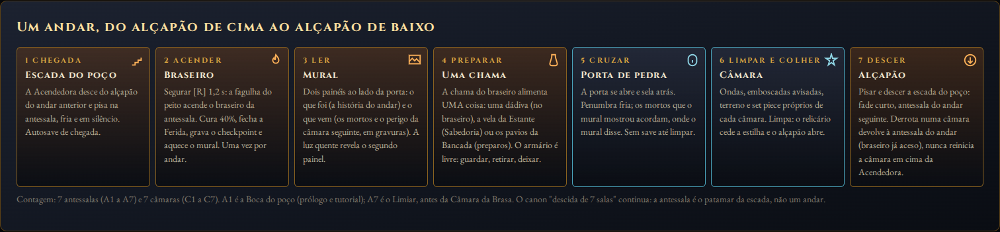

---

## 1. Diagnóstico franco

### 1.1 Por que a porta lateral e a antecâmara não fazem sentido na história

`[CÓDIGO]` Hoje (`rota.ts`, `cryptLayouts.ts` `rect({ sideDoor })`, `cryptDoor.ts`, `exitMarkers.ts`,
`main.ts` `takeSideDoor`/`enterNode`): depois de colher a estilha, abrem-se juntas o alçapão
(no eixo, perto do relicário) e uma porta na parede leste. A porta leva a uma sala 12 x 12
(`camara_12`) com o tema do andar de origem, sem mobília, sem eco, sem inscrição, com uma escada
no fundo que leva ao andar seguinte. O plano de qual porta aparece (Estante ou Bancada) vem de
`planRoute(seed)`.

`[DESIGN]` O problema não é de implementação; é de ficção e de forma:

- O canon diz que o poço é uma **descida vertical em câmaras seladas, uma por vez**
  (`narrativa-e-historia.md` 1.3). Uma porta lateral que leva a outra sala com **a sua própria
  escada** cria duas escadas por andar e um ramo horizontal numa geografia que só desce. O jogador
  sente a contradição mesmo sem nomeá-la: "para onde vai essa sala?".
- A antecâmara é **vazia**: planta retangular, nenhum objeto, nenhum marco, nenhuma voz. Chama-se
  "Estante" ou "Bancada" mas não tem estante nem bancada (as etapas L2 e Q5 não foram feitas). Um
  lugar sem conteúdo é um menu com paredes.
- A escolha é **assimétrica**: de um lado uma tela (o alçapão abre uma UI sobre fundo preto); do
  outro um lugar. O jogador compara uma transação com um passeio. A spec de portas tentou compensar
  com cura 40% contra 25%/20%, o que é um número, não uma razão.
- A "visita ao braseiro" nunca foi um braseiro. O W8 trocou "acender o braseiro em cada sala" pela
  estilha e pela tela do relicário; o set piece mais repetido do canon (`spec-set-pieces.md` 2.3,
  "o gesto sagrado do jogo") deixou de existir no mundo. A porta lateral pegou carona nessa ausência.

### 1.2 Por que os salões ainda parecem a mesma sala

`[CÓDIGO]` As sete plantas saem da mesma função `rect()`: entrada ao sul (`spawn` em `z = -halfZ + 3`),
relicário ao norte (`altar` em `z = halfZ - 2,8`), alçapão a 6 m da parede norte, inimigos
nascendo num **anel** em volta de `enemyAnchor` (centro) com jitter por semente, pilares sempre
fora da pista central, faixa de combate (`calm`) sempre a mesma elipse entre o spawn e a saída. O
que varia por andar: dimensões (24 x 24, 36 x 24, 24 x 48), arranjo de pilares (3 funções), tema
(`cryptTheme.ts`: rocha, névoa, etalonagem, partículas), cenografia de **borda** (`cryptProps.ts`:
túmulo, acampamento, cascata, grades, ossuário, fissura, cratera) e o dressing por `RoomKind`.

`[DESIGN]` O que o jogador sente:

- **O mesmo percurso**: entrar pelo sul, lutar no meio, andar até o norte, tocar, descer. Sete vezes.
  A forma muda, o **fluxo** não.
- **A mesma luta**: todos os mortos acordam ao mesmo tempo, no centro, e vêm em linha reta. Não há
  onda, emboscada, inimigo que use o terreno, nem posição que importe. A composição por andar
  (`ROSTER`) já é boa; a disposição a desperdiça.
- **Os marcos ficam na borda**: as cenas de história (o acampamento, as ossadas, a fissura) vivem
  fora da área jogável, como papel de parede. Não se passa por elas; não se decide nada por causa
  delas.
- **O tema é cor**: rocha, névoa e etalonagem distinguem os andares em uma captura, mas não mudam o
  que se faz com as mãos. Identidade de andar que não muda o jogo é skin.

### 1.3 Por que as melhorias não se ligam

`[DESIGN]` As quatro specs de exploração foram escritas como **sistemas** (portas, livros, poções,
cenário vivo), cada um com sua sala, sua UI e sua moeda de tempo. Nenhuma spec responde "o que
o jogador faz entre uma câmara e outra, e por quê". Faltou o **lugar** que amarra: um espaço
onde descansar, ler, preparar e decidir fossem o mesmo gesto. É isso que a antessala é.

---

## 2. O laço novo: antessala, porta de pedra, câmara, alçapão

### 2.1 O que é a antessala

`[DESIGN]` `[NORMATIVO]` A antessala é a **casa de guarda** que a ordem das Acendedoras manteve em
cada patamar do poço: o lugar onde quem descia acendia o braseiro do andar, repunha os frascos no
armário, lia o que as anteriores deixaram escrito e gravava na parede, para quem viesse depois,
o que a câmara seguinte guardava. Quando a ordem ruiu, os patamares ficaram frios; os murais,
no escuro. Cinza desce **reacendendo os patamares** com a fagulha do peito: não acende os
braseiros das câmaras (o W8 continua: as estilhas vão para a Brasa no fundo), acende os
**braseiros dos patamares**, que são dela por direito de linhagem (`narrativa-e-historia.md` 2.2:
"o fogo morto só reconhece a fagulha da linhagem").

Isso resolve a contradição com o canon sem reescrevê-lo: "cada braseiro aceso empurra o escuro um
pouco mais para baixo e destrava a passagem seguinte" (canon 1.4) volta a ser literal, e "nada
de acender o fogo a cada andar" (W8) continua verdadeiro para as **câmaras**.

Nome: o usuário diz "antessala"; o glossário tem "antecâmara" (corredor/antecâmara, tipo de sala do
canon 3.2). Proposta: **antessala** vira o termo de jogo (nome de exibição e id `antessala`), e
"antecâmara" fica como o tipo de sala do canon, que esta proposta materializa. Ver pergunta 12.

`[NORMATIVO]` Conteúdo fixo de toda antessala (planta 12 x 12, a `camara_12` que já existe; A6 é
12 x 18):

| Peça | Onde | O que faz | Reaproveita |
|---|---|---|---|
| Boca da escada (E) | canto sudoeste | por onde a Acendedora chega de cima; autosave de chegada | peça `stairs` do kit; `enterNode` vira `enterAntessala` |
| Braseiro (B) | eixo, um pouco ao sul | segurar [R] 1,2 s acende: cura 40%, fecha a Ferida, checkpoint, aquece o mural, abre o painel de dádivas, entrega a **chama** | `brazier` do kit, `channelBar`, `boonShop.ts`, `setBrazierLit` |
| Armário (A) | parede oeste | guardar, retirar, deixar frascos; reserva da ordem (a banca de hoje) | `clusterAlchemy` (estantes com frascos), novo painel `ds-frame` |
| Ofício (O) | parede leste | Estante (A2, A4) ou Bancada (A3, A5), as duas em A6; nenhum em A1 e A7 | specs L2 e Q5 (dressing e UI já desenhados) |
| Mural (M) | parede norte, dos dois lados da porta | painel "o que foi" (frio) e painel "o que vem" (aceso); inscrição do andar | `illustrations.ts`, `gameHud.setInscription`, decalques da Crônica |
| Porta de pedra | centro da parede norte | abre ao aproximar; sela atrás; a câmara começa | `wall_gate_door` + véu e poça de `cryptDoor.ts` |

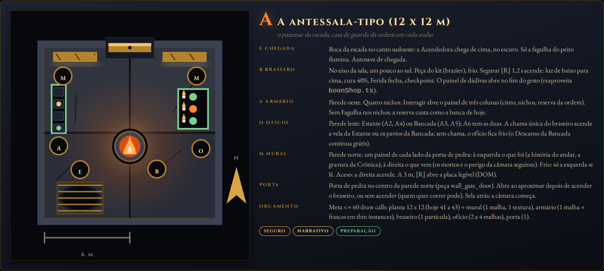

### 2.2 Os sete passos de um andar

`[NORMATIVO]`

| # | Passo | Lugar | O que acontece | Save |
|---|---|---|---|---|
| 1 | Chegada | antessala, fria | a Acendedora desce a escada do alçapão anterior; só a fagulha ilumina; o mural "o que foi" se lê, "o que vem" está no escuro | autosave de chegada (`andar:n` na Crônica) |
| 2 | Acender | braseiro | [R] 1,2 s; luz sobe de baixo para cima (coreografia do roadmap 3.5); cura 40%; Ferida fecha; o painel de dádivas abre no fim do gesto; a **chama** fica disponível | checkpoint |
| 3 | Ler | mural | a 3 m, [R] abre a placa (DOM) com os dois painéis legíveis; `mural:n` na Crônica | autosave |
| 4 | Preparar | armário, ofício | guardar/retirar/deixar frascos; gastar a chama na Estante ou na Bancada (ou já ter gasto na dádiva) | autosave a cada ação |
| 5 | Cruzar | porta de pedra | aproximar abre; cruzar sela; `enterRoom(i)`; os mortos acordam conforme a planta (ondas, emboscadas, vigília) | nenhum (combate) |
| 6 | Limpar e colher | câmara | combate; relicário cede a estilha; alçapão abre | nenhum |
| 7 | Descer | alçapão | pisar e descer; fade; antessala do andar seguinte | checkpoint = chegada |

Quem quer só correr pode: nada obriga a acender (a porta abre sem braseiro). O custo de pular é não
ver "o que vem", não curar, não ter chama.

### 2.3 O que substitui o quê

| Hoje `[CÓDIGO]` | Redesenho `[DESIGN]` | Reinterpretação na ficção |
|---|---|---|
| Alçapão da Brasa abre a tela "Relicário da Brasa" | Alçapão leva à **antessala**; o braseiro é objeto; o painel de dádivas abre ao acender | o alçapão é a boca da escada do poço; a tela era o braseiro que faltava |
| Porta lateral na parede leste | **Removida** | não existe cômodo lateral num poço; o patamar é o cômodo |
| Antecâmara 12 x 12 vazia + escada no fundo | **Antessala** 12 x 12 mobiliada; a escada é a chegada, não a saída | a sala que existia sem razão passa a existir com todas |
| Estante e Bancada como antecâmaras sorteadas (`planRoute`) | **Ofícios fixos por antessala** (A2 e A4 Estante; A3 e A5 Bancada; A6 ambas) | a ordem tinha scriptorium e botica em patamares certos; o mural os anuncia |
| D1: a porta substitui a visita ao braseiro | D1 ajustada: **uma chama por andar** alimenta dádiva OU Estante OU Bancada | "uma chama, um gesto": a mesma fagulha que alimentaria a dádiva acende a vela ou os pavios |
| Cura 40% / 25% / 20% por saída | Cura 40% em toda antessala, ao acender | a cura diferenciada só servia para empurrar a escolha de porta |
| Câmara Esquecida (laje rachada, aditiva) | Mantida como está; a saída dela volta ao alçapão | já é aditiva e com preço; não conflita |
| Derrota reinicia o andar com os mortos de volta | Derrota devolve à **antessala** do andar | fogueira: o lugar onde se respira e se tenta de novo |

Compromisso de 0,6 s (`stepCommit`): deixa de ser necessário no alçapão (saída única) e fica para
a laje secreta e para a porta de pedra (0,4 s, para não cruzar sem querer durante a leitura do
mural, que fica ao lado).

### 2.4 A chama única: D1 ajustada, economia e paridade

`[CÓDIGO]` Fagulha acumulada ao chegar ao Guardião: 176 (spec de portas 4.1); gasto plausível
~95. A escassez real era a **visita** (6 por descida), e a paridade entre as saídas estava em
~12 fagulhas equivalentes por prêmio (dádiva, ponto de Sabedoria, preparos).

`[DESIGN]` `[NORMATIVO]` A chama substitui a visita como recurso escasso. Regras:

- Acender o braseiro da antessala entrega **1 chama**. Ela não é item nem número no HUD: é um
  estado do braseiro ("a chama ainda está no braseiro" / "a chama foi levada").
- A chama alimenta **uma** coisa: (a) uma dádiva no painel do braseiro (como hoje: 1 de cada ramo +
  Lasca grátis; o preço em Fagulha continua); (b) a vela da Estante (uma leitura, +1 Sabedoria;
  o Volume lacrado pago e o Livro Proibido continuam como na spec de livros); (c) os pavios da
  Bancada (3 preparos; o Descanso continua grátis e sem chama).
- A **Lasca de Brasa grátis** continua existindo sem chama (nunca travar), como hoje.
- A chama **não** é salva como pendente entre sessões: o autosave grava "gasta em" (`chama:
  "dadiva" | "estante" | "bancada" | ""`); retomar com `""` deixa a chama no braseiro.
- Paridade (régua da spec de portas 4.2): dádiva 12 ✦ eq.; leitura 12 ✦ eq.; 3 preparos + Unguento
  ~11 ✦ eq. Mesma margem de 2 a 3 ✦ de antes, sem a cura como moeda.
- Taxa-alvo no playtest: 40% a 60% das chamas fora da dádiva. Botões: preço do lacrado, número de
  pavios, cura do Descanso.

Por que isto é melhor do que a porta: a escolha acontece **com o mural à vista**. O jogador vê
que a Cisterna que Cede tem prazo e um arqueiro e decide se quer Unguento (Bancada), alcance de
fogo (Estante, Linha Fogo) ou Fôlego (dádiva). Informação antes da decisão (Hades), num lugar
seguro (Dark Souls), com preparo que custa algo (Darkest Dungeon, Slay the Spire).

### 2.5 Derrota, Continuar, salvamento e Crônica

`[NORMATIVO]` O fluxo fecha assim (substitui R7 e R8 da spec de portas):

- **Lugar** (`Place` em `rota.ts`): `{ kind: "antessala", index }` ou `{ kind: "camara", index }`.
  `floorIndex` continua sendo o andar (a antessala A(i) e a câmara C(i) têm o mesmo índice `i`).
- **Checkpoint** = chegada à antessala (como hoje é a chegada ao andar) e acender o braseiro. A
  câmara nunca salva no meio (regra do canon, `spec-fluxo-e-persistencia.md` 4).
- **Derrota** (`retryFloor`): volta à **antessala** do andar, vida cheia (como hoje), Ferida zerada,
  braseiro no estado em que estava (aceso ou não), chama no estado em que estava (gasta não volta),
  cinto e nichos intactos, dádivas e Sabedoria mantidas. A câmara é remontada ao cruzar a porta
  (mortos restaurados, estilha no relicário). Morrer na antessala é impossível (sem inimigos; o
  Livro Proibido e a Câmara Esquecida mantêm a regra R8 atual: recomeçam no lugar, sem repetir a
  emboscada).
- **Continuar** (título): retoma na antessala do andar salvo, com o estado do braseiro e da chama.
  Se o save estava numa câmara (fechou a aba no meio do combate), retoma na antessala desse andar:
  nunca no meio de uma luta.
- **Instabilidade** (andar 3): a queda leva ao andar 4 **pela antessala A4** (não direto à câmara):
  a Acendedora cai no patamar, sem a visita ao braseiro de C3 (que ela não chegou a usar) mas com a
  antessala A4 normal. O custo da queda continua o da spec de cenário vivo (dano 12%, perde o
  bônus da câmara e a Fagulha dos mortos que restavam); deixa de "perder a tela do braseiro".
- **Crônica** (`codex.ts`): marcas novas `mural:n` (leu o mural de A(n)) e `acendeu:n` (acendeu o
  braseiro de A(n)). O decalque do andar `n` passa a ter dois estados: **gravura** (desbloqueada por
  `mural:n`) e **gravura + texto** (por `leitura:n`, a inscrição dentro da câmara, como hoje). Os
  nichos (personagens, lugares) continuam por `andar:n` e `guardiao:caiu`. Verbete de lugar novo:
  "A antessala" (sempre desbloqueado) e "O armário da ordem" (ao deixar o primeiro frasco).
- **Leaderboard**: continua valendo o tempo total; antessalas custam tempo real.

### 2.6 Referências (uma linha cada)

- Hades: a porta mostra o prêmio antes de entrar e o jogador escolhe com informação; a prévia honesta vira decisão ([Prima Games](https://primagames.com/tips/hades-door-symbols-guide-boons-artifacts), [Hades Wiki](https://hades.fandom.com/wiki/Chambers_and_Encounters)).
- Dark Souls: a fogueira é o ponto de descanso e o checkpoint, "um centro de relaxamento num mundo sombrio" segundo Miyazaki, e reabastece os frascos a cada descanso ([Wikipedia, Bonfire](https://en.wikipedia.org/wiki/Bonfire_(Dark_Souls))).
- Darkest Dungeon: o preparo antes da expedição decide a sobrevivência; cada área pede provisões diferentes ([GameSkinny](https://www.gameskinny.com/tips/darkest-dungeon-provisioning-guide/)).
- Hollow Knight: o banco cura, salva e é onde se trocam amuletos; a escassez de bancos é uma ferramenta de tensão e cada banco é desenhado como parte do lugar ([Hollow Knight Wiki](https://hollowknight.wiki/w/Bench_(Hollow_Knight))).
- Dead Cells: as Passagens entre biomas são salas de transição com fontes que reabastecem os frascos, e o reabastecimento escala com a dificuldade ([Dead Cells Wiki, Passages](https://deadcells.wiki.gg/wiki/Passages)).
- Slay the Spire: a fogueira é uma bifurcação (descansar ou melhorar), um nó de tempo dentro de uma estrutura de risco e recompensa ([design tensions](https://saschb2b.github.io/game-mechanics/games/slay-the-spire/design-tensions), [guia de rest sites](https://sts2.untapped.gg/en/guides/rest-sites)).

---

## 3. As sete câmaras

`[DESIGN]` Princípios que valem para todas:

- **A composição por andar não muda** (`ROSTER` em `main.ts`): o que muda é onde e quando cada
  morto acorda. Variedade barata.
- **A IA anda em linha reta** (sem navegação). Nenhuma planta separa herói e morto com parede;
  os anexos (nichos, galerias, braços de transepto) são de onde os mortos **saem**, não onde
  ficam. Pilares continuam fora da pista central. Plantas com obstáculo central (nenhuma aqui)
  exigiriam um desvio tangente na IA: deixado fora de propósito.
- **Honestidade do mural**: o que o painel "o que vem" mostra está na câmara, inclusive emboscada
  e onda 2 (o glifo de olho e o glifo de duas ondas avisam).
- **Marcos na área jogável**: pelo menos um marco por câmara fica no caminho (não na borda), e
  pelo menos um é lido por proximidade ([R]), como hoje as inscrições.
- **Dimensões múltiplas de 12 m** (ladrilho de 6, parede de 4), como `cryptLayouts.ts` exige; os
  anexos têm 2,5 a 6 m de profundidade e usam a mesma peça de parede.
- **Teto de 90 draw calls por câmara** (GPU real, contador do Babylon que inclui sombra e contorno);
  linha de base atual: 54, 65, 58, 80, 72, 76, 50 (spec-exploracao-indice 13).

Legenda das plantas: faixa tracejada = faixa de combate (`calm`); bustos em gelo = mortos (anel
tracejado = onda 2; anel pontilhado = emboscada avisada); números = chave ao lado; E, B, A, O, M =
escada, braseiro, armário, ofício, mural.

### 3.1 C1 Câmara dos Bancos (andar 1, guarda; antessala A1 A Boca)

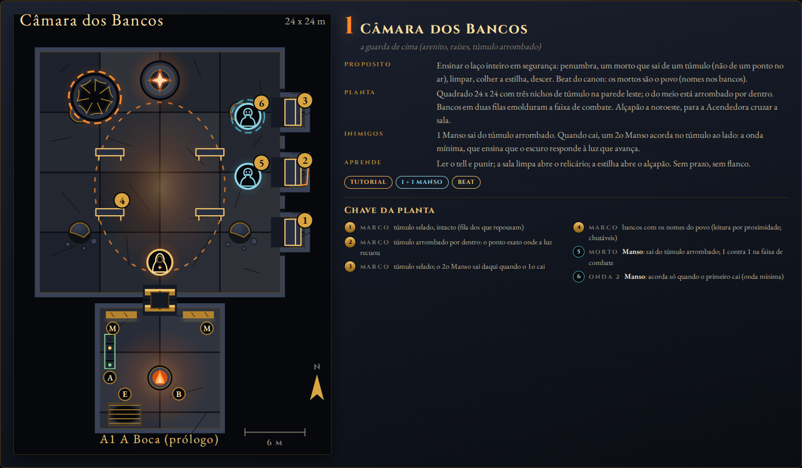

| | |
|---|---|
| Propósito | Ensinar o laço inteiro em segurança: penumbra, um morto que **sai de um túmulo**, limpar, colher a estilha, descer. Beat: os mortos são o povo. |
| Planta | 24 x 24 com três nichos de túmulo (2,5 m) na parede leste; o do meio arrombado por dentro. Bancos chutáveis (`StrikeProp` kick) em duas filas. Alçapão a noroeste. |
| Marcos | fila de túmulos selados e um arrombado (canon 7.3); bancos com nomes (leitura [R]); relicário num nicho raso. |
| Inimigos | 1 Manso sai do túmulo arrombado (animação `LayToIdle` já existe na biblioteca: o morto se levanta). Quando cai, o 2o Manso acorda no túmulo ao lado. Total 2 (hoje 1). |
| Set piece | o primeiro despertar (`spec-set-pieces.md` 2.2), agora literal: o morto sai do jazigo. |
| Aprende | ler o tell e punir; sala limpa abre o relicário; estilha abre o alçapão. Sem prazo, sem flanco. |
| Antessala A1 | a Boca do poço: prólogo. Mural: Marta e a geada (o que foi), 1 Manso e o túmulo (o que vem). Armário com a poção de Marta (o `inv.vida = 1` de hoje vira um frasco a retirar). Braseiro: o primeiro acender, guiado. Sem ofício. |
| Custo | +2 draw calls (nichos fundidos; bancos já são thin instances). |

### 3.2 C2 Salão do Acampamento (andar 2, salão; antessala A2 O Scriptorium)

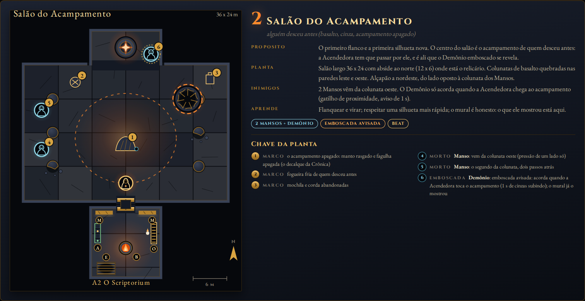

| | |
|---|---|
| Propósito | O primeiro flanco e a primeira silhueta nova. O acampamento de quem desceu antes fica **no eixo**: tem que se passar por ele, e é ali que o Demônio se revela. Beat: alguém desceu antes. |
| Planta | 36 x 24 com abside ao norte (12 x 6) onde está o relicário; colunatas de basalto quebradas a leste e oeste; alçapão a nordeste. |
| Marcos | acampamento (manto rasgado + fagulha apagada, o decalque 2 da Crônica, leitura [R]); fogueira fria; mochila e corda. |
| Inimigos | 2 Mansos da colunata oeste ao entrar; Demônio emboscado na abside, acorda ao tocar o acampamento (gatilho de proximidade 3 m, aviso de 1 s: cinzas sobem, rangido de ossos). |
| Set piece | eco das Acendedoras (2.7): ao chegar ao manto, a fagulha apagada solta uma última fagulha. |
| Aprende | flanquear e virar; respeitar uma silhueta mais rápida; o mural é honesto. |
| Antessala A2 | o Scriptorium: Estante (primeira Sabedoria; marginálias de Marta, D6). Mural: o manto (o que foi), 2 Mansos + Demônio + olho (o que vem). |
| Custo | +1 (abside fundida; o acampamento já existe em `cryptProps.camp`, só muda de lugar). |

### 3.3 C3 Cisterna que Cede (andar 3, cisterna; antessala A3 A Botica)

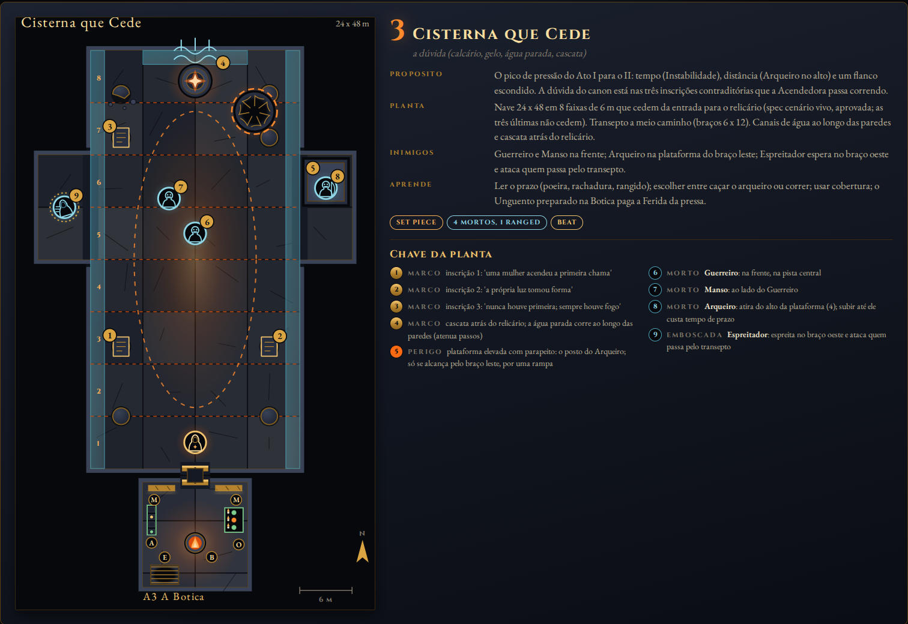

| | |
|---|---|
| Propósito | O pico de pressão: tempo (Instabilidade, aprovada), distância (Arqueiro no alto) e um flanco escondido. Beat: a dúvida (três inscrições que se contradizem). |
| Planta | nave 24 x 48 em 8 faixas de 6 m (as três últimas não cedem), transepto a meio caminho (braços 6 x 12), canais de água rasa ao longo das paredes, cascata atrás do relicário; alçapão no platô final. |
| Marcos | três pilares com inscrições contraditórias (canon 7.4, leitura [R]); plataforma elevada com parapeito no braço leste (rampa pelo braço); cascata. |
| Inimigos | Guerreiro e Manso na frente; Arqueiro na plataforma (só se alcança pelo braço leste); Espreitador espera no braço oeste e ataca ao passar pelo transepto (gatilho de linha de visão). |
| Set piece | Instabilidade como na spec de cenário vivo (160 s, faixas de 6 m, cataclismo só sem estilha, queda com a estilha). A queda leva à antessala A4. |
| Aprende | ler o prazo; escolher entre caçar o arqueiro e correr; cobertura; o Unguento paga a Ferida da pressa. |
| Antessala A3 | a Botica: Bancada (primeiro Unguento; o armário já tem 1 Unguento de Marta). Mural: as três colunas e a água (o que foi), 4 bustos + chão que cede + água (o que vem). |
| Custo | +2 (plataforma e parapeito fundidos; canais de água = 2 placas) + as placas da Instabilidade (+1, spec). |

### 3.4 C4 Salão das Grades (andar 4, salão; antessala A4 A Sala dos Nomes)

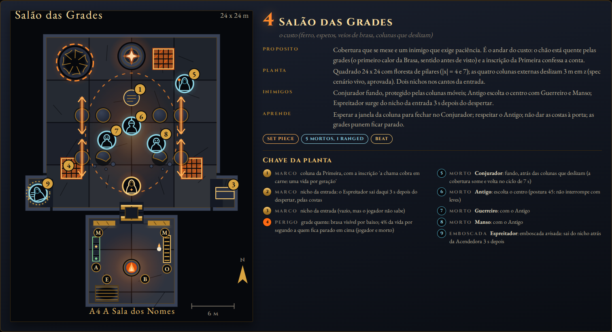

| | |
|---|---|
| Propósito | Cobertura que se mexe e um inimigo que exige paciência. O chão está quente pelas grades: o primeiro calor da Brasa, sentido antes de visto. Beat: o custo. |
| Planta | 24 x 24, floresta de pilares (|x| = 4 e 7); as quatro colunas externas deslizam 3 m em z (aprovado); dois nichos de 2,5 m nos cantos da entrada; três grades no chão; alçapão a noroeste. |
| Marcos | coluna central com a inscrição da Primeira ("a chama cobra em carne"); grades com brasa por baixo (zona quente: 4% da vida por segundo a quem fica parado, jogador e morto, com aviso de calor no HUD); nichos da entrada. |
| Inimigos | Conjurador fundo, atrás das colunas móveis; Antigo escolta o centro com Guerreiro e Manso; Espreitador sai do nicho sudoeste 3 s depois do despertar, pelas costas (aviso: tampa do nicho range 1 s antes). |
| Set piece | colunas deslizantes (spec de cenário vivo, 7 s de ciclo, pausa de 1,2 s). |
| Aprende | esperar a janela da coluna para fechar no Conjurador; respeitar o Antigo; não dar as costas à porta; as grades punem ficar parado. |
| Antessala A4 | a Sala dos Nomes: Estante (livro `rol_nomes`). Mural: a conta da Primeira em marcas de contagem (o que foi), 5 bustos + colunas móveis + olho (o que vem). |
| Custo | +2 (grades = 1 malha emissiva com 3 instâncias; nichos fundidos) + colunas (+1 a +2, spec). |

### 3.5 C5 Santuário das Duas (andar 5, santuário; antessala A5 A Botica Funda)

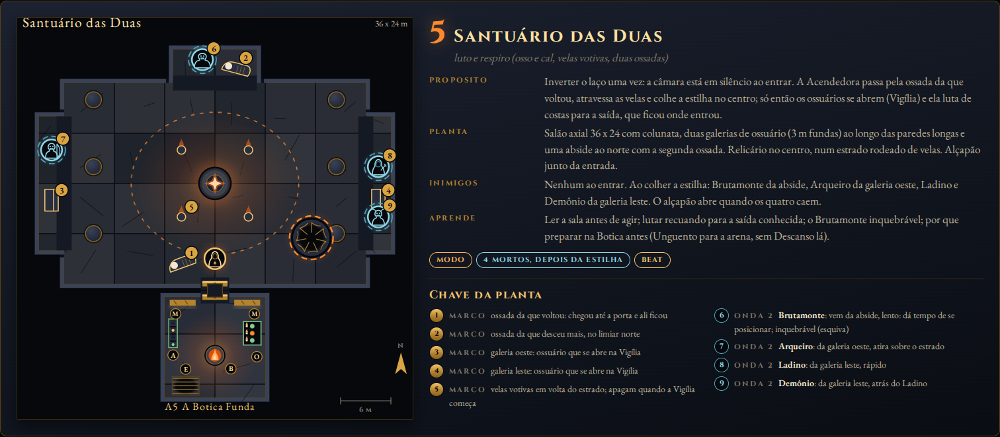

| | |
|---|---|
| Propósito | Inverter o laço uma vez. A câmara está em **silêncio** ao entrar; a Acendedora passa pela ossada da que voltou, atravessa as velas e colhe a estilha no centro; só então os ossuários se abrem (**Vigília**) e ela luta de costas para a saída, que ficou onde entrou. Beat: luto e respiro. |
| Planta | 36 x 24 axial com colunata; duas galerias de ossuário (3 m) ao longo das paredes longas; abside ao norte com a segunda ossada; relicário no centro, num estrado rodeado de velas; alçapão junto da entrada. |
| Marcos | as duas ossadas de Acendedoras (`acendedoraRemains`, poses supina e curvada, já existem; passam para a área jogável, leitura [R]); velas votivas (apagam quando a Vigília começa: deixa de luz); galerias. |
| Inimigos | nenhum ao entrar (`RoomDef.mode: "vigilia"`). Ao colher a estilha: Brutamonte da abside (lento), Arqueiro da galeria oeste, Ladino e Demônio da galeria leste. O alçapão abre quando os quatro caem. |
| Set piece | a Vigília (reusa o conceito da Câmara Esquecida da spec de portas: "ao pegar o prêmio, os mortos acordam"). |
| Aprende | ler a sala antes de agir; lutar recuando para a saída conhecida; esquivar o inquebrável do Brutamonte; por que preparar antes (a arena do Guardião não tem Descanso). |
| Antessala A5 | a Botica Funda: Bancada; armário com 1 Fúria. Mural: duas ossadas (o que foi), vela da vigília + 4 bustos (o que vem). |
| Custo | +2 (galerias e abside fundidas; estrado = o `dais` que já existe). Velas: `floorArt.candles` já existe no santuário. |

### 3.6 C6 Forja da Primeira Fagulha (andar 6, cisterna da Origem; antessala A6 A Casa da Ordem)

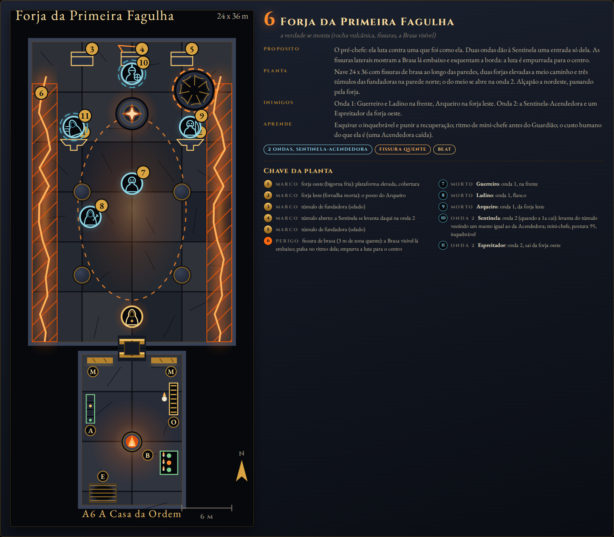

| | |
|---|---|
| Propósito | O pré-chefe (`narrativa-e-historia.md` 5.3): ela luta contra uma que foi como ela. Duas ondas dão à Sentinela uma entrada só dela. As fissuras laterais mostram a Brasa lá embaixo e esquentam a borda: a luta é empurrada para o centro. Beat: a verdade se monta. |
| Planta | 24 x 36 com fissuras de brasa (3 m) ao longo das paredes, duas forjas elevadas a meio caminho (cobertura e posto do arqueiro), três túmulos das fundadoras na parede norte; alçapão a nordeste. |
| Marcos | forja (bigorna e fornalha mortas: a lenda da origem, leitura [R]); os três túmulos, o do meio se abre; a fissura pulsa no ritmo da Brasa (emissivo, custo zero). |
| Inimigos | onda 1: Guerreiro e Ladino na frente, Arqueiro na forja leste. Onda 2 (quando a 1a cai, 2 s de silêncio e um rangido): a **Sentinela** se levanta do túmulo do meio vestindo um manto igual ao da Acendedora (variante de tinta `manto_*` já existe) e um Espreitador sai da forja oeste. |
| Set piece | ecos sobrepostos (três ecos do andar 6 no canon) ao passar pela forja; a Sentinela tem uma frase antes de atacar ("Eu não consegui voltar.", voz da que Falhou). |
| Aprende | esquivar o inquebrável e punir a recuperação; ritmo de mini-chefe antes do Guardião; o custo humano. |
| Antessala A6 | a Casa da Ordem (12 x 18): Estante e Bancada. Mural: a forja e a Primeira (o que foi), duas ondas + Sentinela com o manto (o que vem). |
| Custo | +3 (forjas = 2 plataformas fundidas; fissura emissiva já existe no tema `fissura`, passa de borda para dentro). |

### 3.7 C7 Câmara da Brasa (andar 7, Guardião; antessala A7 O Limiar)

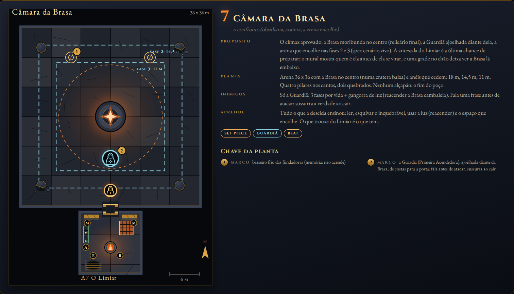

| | |
|---|---|
| Propósito | O clímax aprovado: a Brasa moribunda no **centro**, a Guardiã ajoelhada diante dela de costas para a porta, a arena que encolhe nas fases 2 e 3. Beat: o confronto. |
| Planta | 36 x 36, Brasa no centro numa cratera baixa (hoje o braseiro do chefe fica no `altar` ao norte; passa ao centro, como `spec-chefe-guardiao.md` 3 pede); anéis que cedem em 14,5 m e 11 m; quatro pilares nos cantos. Sem alçapão. |
| Marcos | a Brasa; dois braseiros frios das fundadoras; a Guardiã. |
| Inimigos | só a Guardiã (3 fases + gangorra de luz, já no código). |
| Set piece | entrada na arena (2.5: ela se levanta e se vira) e reavivar a Brasa (2.6). Arena que encolhe (spec de cenário vivo). |
| Aprende | tudo: ler, esquivar o inquebrável, reacender, o espaço que encolhe. |
| Antessala A7 | o Limiar: braseiro, armário, mural (a Primeira ficou / a que guarda o fogo, com a arena que encolhe), sem ofício; uma grade no chão deixa ver o clarão da Brasa lá embaixo. A última dádiva. |
| Custo | 0 (mover o braseiro; os anéis já estão orçados na spec: +2). |

### 3.8 As sete antessalas (resumo)

| Antessala | Nome | Ofício | Armário inicial | Mural: o que foi | Mural: o que vem |
|---|---|---|---|---|---|
| A1 | A Boca (prólogo) | nenhum | 1 Recuperação (de Marta) | Marta na geada; a boca do poço | 1 Manso + túmulo arrombado |
| A2 | O Scriptorium | Estante | vazio | o manto rasgado | 2 Mansos, Demônio, olho |
| A3 | A Botica | Bancada | 1 Unguento (de Marta) | as três colunas e a água | Guerreiro, Manso, Arqueiro, Espreitador, chão que cede, água |
| A4 | A Sala dos Nomes | Estante | vazio | a conta em marcas (uma vida por geração) | Conjurador, Antigo, Guerreiro, Manso, Espreitador, colunas móveis, olho |
| A5 | A Botica Funda | Bancada | 1 Fúria | duas ossadas | vela da vigília, Brutamonte, Arqueiro, Ladino, Demônio |
| A6 | A Casa da Ordem | Estante + Bancada | vazio | a forja e a Primeira | duas ondas, Guerreiro, Ladino, Arqueiro; Sentinela com manto, Espreitador |
| A7 | O Limiar | nenhum | vazio | a Primeira ficou | a Guardiã; a arena que encolhe |

A1 e A7 não têm ofício de propósito: a primeira ensina (braseiro, mural, armário) e a última
pesa (só o que se trouxe). A chama de A1 só serve para a dádiva (a Lasca grátis ou uma dádiva
com as 0 Fagulhas iniciais: na prática, ensina a tela); a chama de A7 é a última dádiva.

---

## 4. Poções: o gole, o armário, guardar e retirar

### 4.1 O gole (especificação para o animador e para o agente de código)

`[CÓDIGO]` Hoje `tryPotions` (`main.ts`) consome a tecla, checa `hero.combat.canDrink` (fora de
golpe) e aplica o efeito **no mesmo quadro**: sem gesto, sem janela, sem som além do `healChime`.
Clipes da heroína (`heroModel.ts` `CLIPES`): Idle_Loop, Walk_Loop, Jog_Fwd_Loop, Sprint_Loop,
Sword_Regular_A/B, Roll, Sword_Block, Hit_Chest, Spell_Simple_Shoot, Death01. A biblioteca
`anim.glb` tem 22 clipes e **não tem Drink nem Interact** (lista conferida: Death01, Hit_Chest,
Hit_Knockback, Idle_Loop, Jog_Fwd_Loop, LayToIdle, Melee_Hook, OverhandThrow, Punch_Cross,
Punch_Jab, Roll, Spell_Simple_Idle_Loop, Spell_Simple_Shoot, Sprint_Loop, Sword_Block, Sword_Idle,
Sword_Regular_A, Sword_Regular_B, Walk_Loop, Zombie_Idle_Loop, Zombie_Scratch,
Zombie_Walk_Fwd_Loop). O retarget é por nome de osso (`quaterniusRig.retargetClips`); o rig é o
Quaternius UAL (`tools/personagens/anim.py` junta UAL1 + UAL2 e `gerar.py` escolhe os clipes).

`[NORMATIVO]` O gesto:

| t (s) | Fase | Corpo | Regra |
|---|---|---|---|
| 0,00 | toque | a mão livre vai ao cinto; o frasco aparece na mão (malha mínima do kit `bottle_*`, 1 instância, escala 0,35) | só com `canDrink`; a tecla é consumida como hoje |
| 0,00 a 0,30 | levar à boca | braço sobe, cabeça inclina 15 graus para trás a partir de 0,20 | **janela vulnerável**: sem leve, pesado, bloqueio, fogo; anda a 60%; esquivar cancela **sem gastar a carga** |
| 0,30 | gole | o frasco inclina | a carga é consumida e o efeito aplica aqui; esquivar depois disto não devolve nada |
| 0,30 a 0,60 | descer e soltar | braço desce, o frasco cai e se desfaz em fagulhas | ainda sem ataque; a locomoção retoma por mistura no idle |

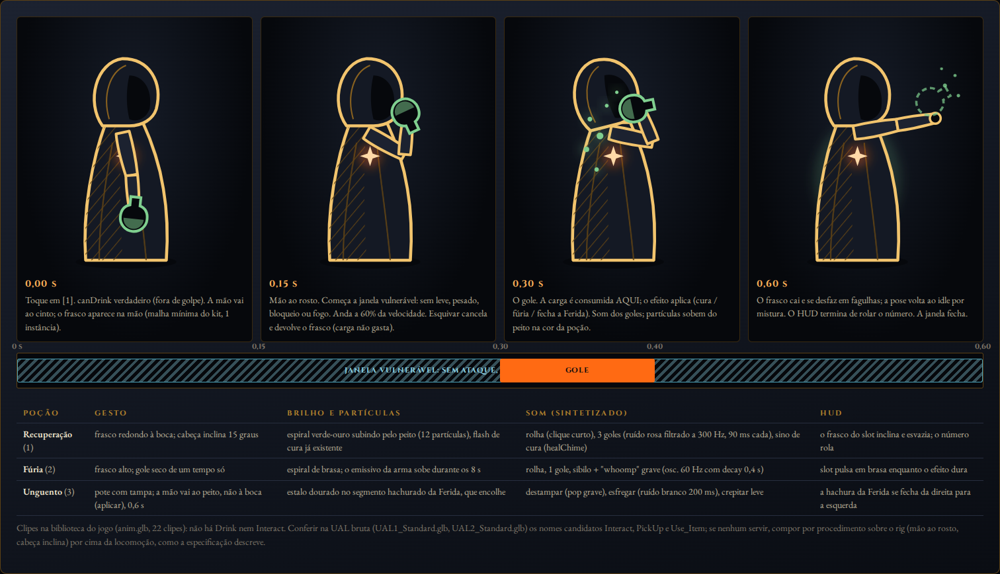

Clipe: **primeiro** conferir na UAL bruta (`UAL1_Standard.glb`, `UAL2_Standard.glb`, no pacote
`quaternius-ual1/2` que `gerar.py` recebe por argumento) os nomes candidatos `Interact`, `PickUp`
e `Use_Item`; se um deles tiver a mão subindo à altura do rosto, adicioná-lo à lista `CL` de
`gerar.py` com o nome `Drink` lógico em `CLIPES` e posicioná-lo pela mecânica como os outros
(`SINCRONIA CLIPE x MECÂNICA` em `heroModel.ts`: âncoras aos 0,15, 0,30 e 0,60 s). **Se não
houver**, compor por procedimento sobre a locomoção: sobrescrever, só nos ossos do braço livre
(`upperarm_l`, `lowerarm_l`, `hand_l`) e do pescoço/cabeça (`neck`, `head`), uma pose-alvo
interpolada (ease-out 0,15 s, hold 0,15 s, ease-in 0,30 s), por cima do clipe de locomoção que
estiver tocando. É o mesmo padrão de "no máximo duas animações ativas" que `heroModel.ts` já
impõe, porque a sobrescrita é por pose, não por `AnimationGroup`. O animador decide qual dos dois
caminhos depois de abrir a UAL (pergunta 9).

Unguento (tecla 3, spec de poções): a mão vai ao **peito**, não à boca (aplicar), mesma janela,
sem inclinar a cabeça.

Efeitos, som e HUD `[NORMATIVO]`:

| Poção | Brilho e partículas (teto 12) | Som sintetizado (`combatSound`/`uiSound`, sem sample) | HUD |
|---|---|---|---|
| Recuperação | espiral verde-ouro subindo pelo peito; `flashHeal` existente | rolha (clique 8 ms), 3 goles (ruído rosa filtrado a 300 Hz, 90 ms cada, 120 ms de intervalo), `healChime` | o frasco do slot inclina e esvazia; o número rola |
| Fúria | espiral de brasa; emissivo da arma +40% durante os 8 s | rolha, 1 gole, sibilo (ruído branco passa-alta 2 kHz, 150 ms) + "whoomp" (osc. 60 Hz, decay 0,4 s) | slot pulsa em brasa enquanto dura |
| Unguento | estalo dourado no segmento hachurado da Ferida, que encolhe | destampar (pop grave), esfregar (ruído branco 200 ms), crepitar leve | a hachura fecha da direita para a esquerda |
| cancelado (esquiva antes do gole) | nenhum | "negativo" curto (`denyBlip`) | o frasco volta ao slot |

Acessibilidade: com reduced motion, sem partículas (só o flash desligável e o som); o slot não
pulsa. Legenda "[frasco]" quando a opção estiver ligada. Daltonismo: forma do frasco (redondo,
alto, pote) e selo de cera (coração, chama, ponto cruzado) além da cor.

Teste: `__brasa.drink("vida")` em dev; script `play_check`: beber e esquivar aos 0,2 s (carga
intacta), beber e esquivar aos 0,4 s (carga gasta, cura aplicada); medir que a janela bloqueia
`light`/`heavy`/`block`/`ember`.

### 4.2 O armário (objeto e UI)

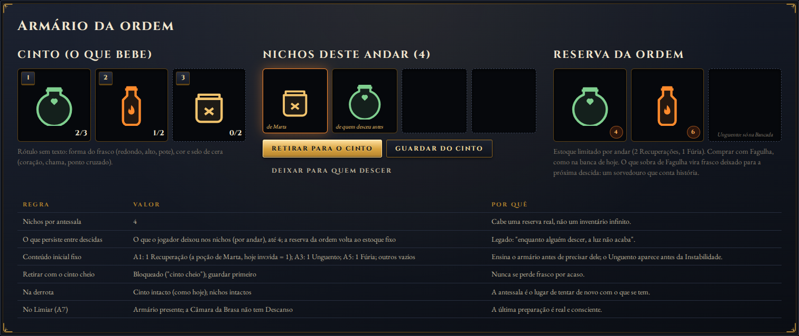

`[NORMATIVO]` Modelo (puro, `game/run/pocoes.ts`):

- **Cinto** = o que ela bebe: 3 slots fixos por tipo com os tetos de hoje (`POTIONS`: Recuperação
  3, Fúria 2, Unguento 2). É o `inv` atual com o Unguento.
- **Nichos** = 4 espaços por antessala, cada um vazio ou com 1 frasco de qualquer tipo. Retirar é
  grátis; retirar com o slot do cinto cheio é bloqueado ("cinto cheio"); guardar move 1 do cinto
  para um nicho vazio; **deixar para quem descer** marca o frasco como legado.
- **Reserva da ordem** = a banca de hoje, com os mesmos preços (4 ✦ e 6 ✦) e estoque fixo por
  antessala (2 Recuperações, 1 Fúria; Unguento só na Bancada). Comprar coloca no cinto (ou num
  nicho, se o cinto estiver cheio).
- **Conteúdo inicial fixo**: A1 1 Recuperação (de Marta; substitui `inv.vida = 1`), A3 1 Unguento
  (de Marta), A5 1 Fúria; o resto vazio. Rótulo: "de Marta" (marginália, D6).
- **Legado** `[A DEFINIR]` (pergunta 4): o que o jogador deixou nos nichos persiste **no perfil**
  (não na run) por antessala, até 4 por antessala. Na descida seguinte, o frasco está lá, com o
  rótulo "de quem desceu antes". A reserva da ordem volta ao estoque fixo. O legado só se grava ao
  cruzar a porta de pedra (não dá para deixar e pegar de volta na mesma visita sem custo de tempo).
- **Derrota**: cinto e nichos intactos (como as poções hoje). **Retomada**: idem (`RunSave.cinto`,
  `RunSave.nichos[andar]`; `Profile.legado[andar]`).
- Objeto 3D: a estante de frascos do `clusterAlchemy` (peças `shelf_small_candles`, `bottle_*`)
  encostada na parede oeste; os frascos presentes são thin instances coloridas por tipo (1 malha);
  marcador DOM `potion` do `exitMarkers.ts` a 6 m, [R] abre o painel (`ds-frame`, três colunas,
  mesma linguagem de `boonShop.ts`). Setas e teclas 1, 2, 3 escolhem; sem mouse obrigatório.

Por que o legado conta a história: a cadeia de Acendedoras é o tema (canon 6.1 "alguém sempre
desce de novo"; o sussurro da Guardiã "não a deixes sozinha"). Cinza acha a poção que Marta
deixou; a Cinza da descida seguinte acha a poção que a Cinza anterior deixou. A sobra de Fagulha
(que hoje não tem destino) vira um gesto para o futuro.

### 4.3 Interação com a Ferida e a Bancada

- Ferida (D2, recomendada): o braseiro da antessala fecha 100% da Ferida ao acender (como a
  "tela do braseiro" fechava na spec); o Descanso da Bancada continua fechando; o Unguento é o
  único remédio **dentro** das câmaras. O armário com 1 Unguento em A3 ensina o remédio antes da
  câmara que mais fere (a Cisterna que Cede).
- Bancada: os preparos vão para o cinto; com o cinto cheio, para um nicho. A Bancada só funciona
  com a chama (pavios acesos); o Descanso é grátis sempre.
- Guarda de desperdício (Q0, já implementada): continua; o gole cancelado por vida cheia não
  acontece (o gesto nem começa: `denyBlip`).
- `spec-pocoes-e-absorcao.md` e `spec-exploracao-pocoes-e-bancada.md`: continuam valendo nos
  números; a "Banca do Braseiro" passa a chamar-se "Reserva da ordem" e mora no armário.

---

## 5. Paredes que contam histórias

### 5.1 O mural da antessala

`[NORMATIVO]` Dois painéis de pedra (6 x 3 m) nos dois lados da porta de pedra, e a inscrição do
andar gravada na verga. O painel esquerdo, **o que foi**, é a cena da história do andar: a mesma
gravura que a Crônica guarda como decalque. O painel direito, **o que vem**, é o aviso: bustos dos
tipos de morto da câmara seguinte com marcas de contagem, o glifo do perigo de cenário (chão que
cede, colunas, água, fissura, anéis), o glifo de situação (olho = emboscada, duas cristas = ondas,
vela = vigília), e, antes do Guardião, a silhueta dela. Sem frase explicativa: só a inscrição.

Estados: **frio** (braseiro apagado): o painel esquerdo se lê a meia-luz; o direito está no
escuro (traço a 15%, dessaturado). **Aceso**: a luz do braseiro sobe pela parede (coreografia de
baixo para cima) e o painel direito acende, com um estalo de pedra quente. A luz lê a pedra: a
primeira vez que isso acontece (A1) é o tutorial do mural, sem texto.

Leitura: a 3 m da verga, marcador `scroll` e [R] abrem a **placa** (DOM, `ds-frame`, mesma
montagem da Crônica: `illustrations.css`, fonte EB Garamond, escala com `uiScale` até 200%),
com os dois painéis lado a lado e a inscrição embaixo. Fechar com qualquer tecla. A placa é o
que garante legibilidade na câmera alta (as paredes quase não se leem de cima, risco 6 do
índice); o painel 3D é a presença no mundo e o convite.

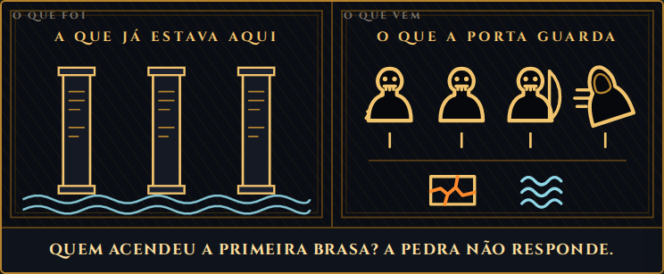
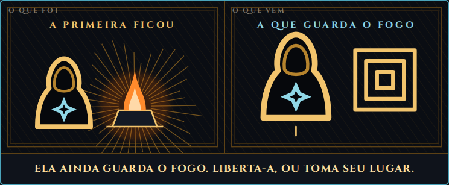

### 5.2 A linguagem: bustos, perigos, contagem

`[DESIGN]` Reutiliza `ui/ds/illustrations.ts` como linguagem (xilogravura em ouro sobre tinta,
classes `.gv-*`, só tokens) e a estende com três famílias de função:

- `bust(kind)`: busto (cabeça e ombros) com o atributo do tipo: Manso (caveira limpa), Guerreiro
  (espada atrás do ombro), Ladino (capuz e adaga), Arqueiro (arco), Conjurador (cajado com orbe,
  a única brasa do painel), Espreitador (capuz inclinado e linhas de pressa), Demônio (chifres),
  Antigo (crista), Brutamonte (ombros largos, sem pescoço), Sentinela (crista e escudo), Guardiã
  (capuz e fagulha apagada em gelo), Acendedora (capuz e fagulha em brasa).
- `hazard(kind)`: chão que cede, colunas móveis, água parada, fissura quente, arena que encolhe,
  vigília, túmulo arrombado, duas ondas, emboscada (olho).
- `tally(n)`: marcas verticais (1 a 5) sob o busto.
- `mural(floor)`: compõe os dois painéis a partir dos dados do andar (seção 5.3) e da composição
  real (`content/descida.ts`): se a composição mudar no tuning, o mural muda junto. Honestidade
  por construção.

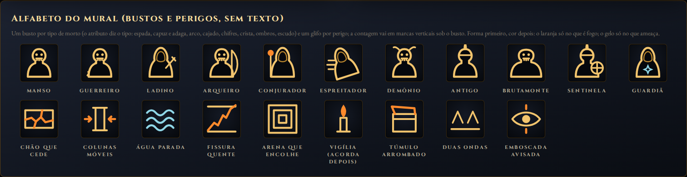

Forma antes de cor: o busto distingue o tipo em cinza; o laranja só no que é fogo (orbe do
Conjurador, fissura, chão quente); o gelo só no que ameaça (fagulha apagada da Guardiã, anéis em
A7, água). Os três testes do mock de exploração (cinza, sem movimento, 200%) valem para a placa.

### 5.3 Os sete murais

| Antessala | O que foi (gravura = decalque da Crônica) | O que vem | Inscrição (já em `codex.ts`) |
|---|---|---|---|
| A1 | Marta encolhida na geada; a boca do poço (plates `marta` e `poco`) | Manso x1; túmulo arrombado | "Aqui jaz a guarda da chama. Foram teu povo, antes do frio." |
| A2 | o manto rasgado e a fagulha apagada (`manto`) | Manso x2, Demônio x1; olho | "Outra desceu por estas escadas. Não a vimos voltar." |
| A3 | três colunas com inscrições e a água (`eco`) | Guerreiro, Manso, Arqueiro, Espreitador; chão que cede; água | "Quem acendeu a primeira Brasa? A pedra não responde." |
| A4 | a conta: fileira de marcas, uma por geração, e a chama (`preco`) | Conjurador, Antigo, Guerreiro, Manso, Espreitador; colunas móveis; olho | "A chama cobra em carne: uma vida por geração." |
| A5 | duas ossadas, uma à porta, outra no limiar (`duas`) | vela da vigília; Brutamonte, Arqueiro, Ladino, Demônio | "Que descanses, tu que voltaste. E tu, que desceste mais." |
| A6 | a forja e a Primeira acendendo (`brasa`) | duas ondas: Guerreiro, Ladino, Arqueiro; Sentinela com manto, Espreitador | "Não temas o fundo. Teme ficar." |
| A7 | a Primeira ficou diante da Brasa (`guardia`) | a Guardiã; arena que encolhe | "Ela ainda guarda o fogo. Liberta-a, ou toma seu lugar." |

As inscrições são as de `FLOOR_INSCRIPTIONS` (uma fonte só). O eco (`FLOOR_ECHOES`) continua
soando ao entrar na **câmara**, como hoje: o mural anuncia, o eco confirma dentro.

### 5.4 Inscrições e marcos nas câmaras

`[NORMATIVO]` Dentro de cada câmara continua havendo a inscrição lida por proximidade (hoje
`readables` + `markRead`), mas ela sai do nicho de parede e vai para o **marco** da câmara (os
bancos em C1, o manto em C2, os três pilares em C3, a coluna da Primeira em C4, as ossadas em C5,
a forja em C6, a Brasa em C7). A inscrição da câmara é a mesma do mural (uma fonte): lê-la
**confirma** o que a parede disse e desbloqueia o texto do decalque.

Paredes das câmaras: sem murais (a câmara é combate e a câmera alta não lê parede). Em vez disso,
**decalques de chão** (o piso já é 3D, `cryptFloor.ts`): a linha de água em C3, o círculo ritual
em C5, as rachaduras radiais em C7 (roadmap 3.5) e, novo, **marcas de contagem gravadas no piso
de C4** (o custo em marcas, de parede a parede).

### 5.5 Como casa com a Crônica sem repetir

`[DESIGN]` Regra: **a parede é futuro, a Crônica é memória**. O mural mostra a gravura e a
ameaça; a Crônica guarda a gravura e o texto. Nunca o mesmo texto em dois lugares:

- O painel "o que foi" usa a **mesma** gravura do decalque do andar (reconhecimento: "eu vi isto
  na parede"); a Crônica adiciona o corpo (os dois parágrafos de `CodexDecal.body`).
- O painel "o que vem" **não** vai para a Crônica como página (seria repetir a câmara); vai como
  uma linha no decalque, só depois de limpar a câmara: "Mortos despertos: 4. O chão cedeu." Isso
  dá à Crônica um registro do que o jogador enfrentou, não do que foi avisado.
- Os nichos de personagem (Marta, a Primeira) continuam por `andar:n` e `guardiao:caiu`; o busto
  da Sentinela-Acendedora vira o nicho novo "A que Falhou" (voz do passado já canônica), por
  `sentinela:caiu`.

### 5.6 Técnica e custo

- Painel 3D: 1 malha (caixa 6 x 3 x 0,3 m, fundida ao cenário estático) com 1 `DynamicTexture`
  (1024 x 512) rasterizada do SVG de `mural(floor)` via `Image` (o SVG já é string); o traço vai
  no canal emissivo (a textura é máscara: o "ouro" acende com a cor de acento do tema). Custo: +1
  draw call, +1 textura por antessala (a textura morre com a sala; cuidado com o vazamento de
  texturas já anotado no índice 13).
- Estados frio/aceso: `emissiveIntensity` 0,15 para 1,0 em 0,8 s ao acender, do painel esquerdo
  para o direito (dois materiais ou um `uv` com gradiente animado: dois materiais é mais simples).
- Placa DOM: zero draw call; reaproveita o componente de página da Crônica.
- Legendas e som: estalo de pedra quente ao acender (síntese), sussurro curto ao abrir a placa
  (reusa `playWhisper`).

---

## 6. Impacto nos documentos e no código

### 6.1 Specs que mudam

| Documento | O que muda | Como |
|---|---|---|
| `spec-exploracao-portas-e-salas.md` | seções 2, 3, 3.1 (porta lateral, antecâmaras, R5, R7, R8) ficam **superadas**; 3.2 (segredos) e 4.1 (economia) continuam | nota no topo apontando para este doc; R5 vira "chama única" |
| `spec-exploracao-indice.md` | diagrama da seção 2; D1 reescrita; fases F1-A/F2 reorganizadas (seção 6.3 abaixo); 13 (registro de F0/F1-A) ganha "parcialmente descartado" | atualizar junto da fase R1 |
| `spec-exploracao-livros-e-sabedoria.md` | a Estante é ofício da antessala (A2, A4, A6), não antecâmara sorteada; "uma leitura por visita" vira "uma leitura por chama"; livros filtrados pelo andar continuam | pequena |
| `spec-exploracao-pocoes-e-bancada.md` | a Bancada é ofício (A3, A5, A6); pavios acendem com a chama; "Banca do Braseiro" vira "Reserva da ordem" no armário; seção nova: cinto, nichos, legado | média |
| `spec-exploracao-cenario-vivo.md` | a queda da Instabilidade leva à antessala A4; o resto igual | uma linha |
| `spec-pocoes-e-absorcao.md` | ponteiro para o gole (4.1) e o armário (4.2) | uma linha |
| `spec-set-pieces.md` | 2.3 (acender o braseiro) volta a existir, na antessala; 2.2 (primeiro despertar) ganha o túmulo de C1; 2.4 = Instabilidade (já decidido) | atualizar 2.3 |
| `spec-fluxo-e-persistencia.md` | estados: `ANTESSALA` entre LOADING e SALA; DERROTA volta à antessala; checkpoint = chegada + acender | seção 2 e 5 |
| `biblia-ambientes.md` | 5.2 (corredor/antecâmara) é a antessala; fichas 5.1 a 5.5 ganham as plantas da seção 3 | média |
| `guia-de-estilo-e-glossario.md` | verbetes: antessala, chama, armário da ordem, nicho, legado, mural, Vigília; "antecâmara" aponta para antessala | pequena |
| `narrativa-e-historia.md` | 5.2 "Antecâmara/corredor: respiro, primeiro gancho de lore" realiza-se como antessala; 7.2 (braseiros como memória) ganha os braseiros dos patamares | nota |
| `00-aprofundamento-e-roadmap.md` | 3.2 matriz de composição: formação por câmara (seção 3 deste doc); 3.5 identidade por sala: as plantas | tabela |

### 6.2 Código: o que se reaproveita e o que se descarta

| Peça `[CÓDIGO]` | Destino |
|---|---|
| `rota.ts`: `planRoute`, `validSequences`, `exitsFor`, `ROTA.nodeHealFrac`, `NodeKind` como antecâmara | **descartar** (o ofício é dado fixo por antessala) |
| `rota.ts`: `Place`, `RouteState` (lugar, gasto, save), `stepCommit`, `mulberry32`, `formatNo`/`parseNo` | **reaproveitar**: `Place` vira `antessala | camara`; `gasto` guarda a chama e os itens da antessala; `no` grava `"antessala@2"` |
| `exploracao.ts` (`ExploracaoHooks`, `ExploracaoRegistry`) | reaproveitar: `onEnterNode` vira `onEnterAntessala` |
| `cryptLayouts.ts`: `rect()`, `camara_12`, `calm`, `pillars*` | reaproveitar; `sideDoor` **descartar**; `rect()` ganha `annex[]` (nichos, galerias, braços, abside), `platforms[]`, `hot[]`; a planta de cada câmara sai para `scenes/crypt/plantas/c1.ts` a `c7.ts` (dados) |
| `cryptDoor.ts` (véu + poça na cor do nó) | reaproveitar como o brilho da **porta de pedra** da antessala (cor `--ember-400`) |
| `exitMarkers.ts` (ícone DOM + anel de compromisso) | reaproveitar como **marcadores de interação** da antessala (braseiro `brazier`, armário `potion`, ofício `book`/`potion`, mural `scroll`, porta `door`) e do alçapão `hatch` |
| `boonShop.ts` | reaproveitar como painel de dádivas aberto ao acender (título "O braseiro aceita a fagulha"); a seção "banca" sai dele e vai para o armário |
| `main.ts`: `enterNode`, `takeSideDoor`, `leaveNode`, `advance()` com `chooseBoon` | **substituir** por `enterAntessala(i)`, `lightBrazier()`, `crossDoor()`, `advance()` (alçapão → antessala i+1) |
| `main.ts`: `tryPotions`, `inv`, `updatePotionHud` | reaproveitar; o consumo passa para `heroCombat.drink()` com janela |
| `cryptRoom.ts`: `RoomDef.node/fromIndex/sideDoor`, `Room.doors` | `node` vira `antessala?: AntessalaDef`; `sideDoor`/`doors` **descartar**; `Room.interactables[]` novo |
| `strings.ts`: `saidaEstante*`, `saidaBancada*`, `promptEscada`, `objNoSair` | descartar/renomear (`antessalaBraseiro`, `antessalaMural`, ...) |
| `tools/test_exploracao.mjs` (21 testes) | reescrever os de rota; manter os de save e ganchos |
| `tools/perf_rooms.cjs` | estender: `enterAntessala(i)` em vez de `enterNode(kind, from)` |
| `codex.ts`: `markFloor`, `markRead`, decalques | reaproveitar; marcas novas `mural:n`, `acendeu:n`, `sentinela:caiu` |
| `illustrations.ts` | estender (bustos, perigos, contagem, `mural(floor)`) |

### 6.3 Fases de implementação

Esforço por agente: baixo (até 1 dia), médio (2 a 4 dias), alto (1 a 2 semanas).

| Fase | O que | Arquivos | Esforço | Depende de |
|---|---|---|---|---|
| R0 Fundação | `Place` novo em `rota.ts`; `content/descida.ts` (dados das 7 câmaras e 7 antessalas: planta, composição, ondas, marcos, mural, ofício, armário inicial); `RoomDef.mode` (`normal`, `vigilia`); campos de save com default (`cinto`, `nichos`, `chama`, `legado` no perfil); eventos `antessala:enter`, `braseiro:lit`, `mural:read`, `armario:change`, `wave:start` | `rota.ts`, `saveData.ts`, novo `content/descida.ts`, `cryptRoom.ts` (só tipos) | baixo | decisões da seção 8 |
| R1 Antessala | pipeline: `enterAntessala`, `advance` para a antessala seguinte, porta de pedra para `enterRoom`, derrota e Continuar para a antessala, queda da Instabilidade para A4; dressing (escada, braseiro, armário 3D, ofício, mural 3D, porta); marcadores DOM | `main.ts` (integrador), novo `scenes/crypt/antessala/` (um arquivo por peça: `escada.ts`, `braseiro.ts`, `armario.ts`, `mural.ts`, `porta.ts`), `exitMarkers.ts` (renomear) | alto | R0 |
| R2 Braseiro e chama | canalização 1,2 s (reusa `channelBar`), cura, Ferida, checkpoint, coreografia de luz, painel de dádivas, estado da chama; Estante e Bancada consomem a chama (L2 e Q5 das specs, com UI) | `antessala/braseiro.ts`, `boonShop.ts`, `estanteUi.ts`, `bancadaUi.ts` | médio | R1 |
| R3 Armário | modelo puro (cinto, nichos, reserva, legado); painel `ds-frame`; objeto 3D; perfil | novo `game/run/pocoes.ts`, novo `game/ui/armarioUi.ts`, `saveData.ts` (perfil) | médio | R0 |
| R4 Gole | janela de 0,6 s em `heroCombat` (`drinkState`, cancel, bloqueio de verbos); clipe UAL ou pose procedural em `heroModel`; VFX; som; HUD | `heroCombat.ts`, `heroModel.ts`, `impactFx.ts`, `combatSound.ts`, `combatHud.ts` | médio | nenhum (pode começar já) |
| R5 Murais | `bust`, `hazard`, `tally`, `mural(floor)` em `illustrations.ts`; placa DOM; textura dinâmica do painel; marcas na Crônica | `illustrations.ts`, novo `ui/muralPlate.ts`, `antessala/mural.ts`, `codex.ts` | médio | R0 (dados), R1 (parede) |
| R6 Câmaras | `rect()` com anexos, plataformas e zonas quentes; sete arquivos de planta; ondas, emboscadas e vigília no `combatDirector` (`wakeGroup`, gatilhos de proximidade e tempo, `onGroupCleared`); mortos dormentes que se levantam (`LayToIdle`); marcos na área jogável; grades quentes; mover a Brasa ao centro em C7 | `cryptLayouts.ts` (base, um agente primeiro), `scenes/crypt/plantas/c1.ts` a `c7.ts` (sete agentes em paralelo), `combatDirector.ts`, `skeleton.ts`, `cryptProps.ts` | alto | R0; set pieces V1, V2, V4 da spec de cenário vivo continuam como estão |
| R7 Afinação e docs | gates de desempenho, playtest (taxa de uso da chama, tempo por antessala, derrotas por câmara), docs da seção 6.1, glossário | tuning, docs | baixo | R1 a R6 |

Paralelismo sem conflito de arquivo (depois de R0, integrada por um agente só):

- **Integrador**: `main.ts`, `rota.ts`, `strings.ts`.
- **Antessala**: `scenes/crypt/antessala/*` (um arquivo por peça: até 5 agentes, desde que a
  interface `AntessalaPiece { build(ctx, def): { dispose() } }` nasça em R0).
- **Armário**: `game/run/pocoes.ts` + `game/ui/armarioUi.ts`.
- **Gole**: `heroCombat.ts` + `heroModel.ts` (o mesmo agente que faria a Ferida Q1 e a Sabedoria
  L1: `heroCombat.ts` é serial).
- **Murais**: `illustrations.ts` + `muralPlate.ts` + `codex.ts` (entradas só acrescentadas).
- **Plantas**: `cryptLayouts.ts` base primeiro (um agente); depois `plantas/c1.ts` a `c7.ts`
  em paralelo (sete agentes); `combatDirector.ts` (ondas) por um agente só.

Ordem recomendada: R0 → (R1 ∥ R3 ∥ R4 ∥ R5-dados ∥ R6-base) → (R2 ∥ R5-parede ∥ R6-plantas) → R7.
O núcleo que muda a sensação já na primeira entrega: R0 + R1 + R2 + R5 (antessala com braseiro e
mural) e C1, C2 e C5 (tutorial, flanco, vigília).

### 6.4 Orçamento de desempenho

`[NORMATIVO]` Medido com `tools/perf_rooms.cjs` em GPU real, mesmo ambiente, antes e depois:

| Lugar | Base (hoje) | Acréscimo previsto | Teto |
|---|---|---|---|
| Antessala (12 x 12) | 41 a 43 | mural +1 (+1 textura), armário +2 (estante + frascos), braseiro +2 (malha + partícula), ofício +2 a +4, escada e porta +1 | **60** |
| C1 | 54 | +2 | 90 |
| C2 | 65 | +1 | 90 |
| C3 | 58 | +2 (+1 Instabilidade) | 90 |
| C4 | 80 | +2 (+2 colunas) = 84, o mais apertado | 90 |
| C5 | 72 | +2 | 90 |
| C6 | 76 | +3 | 90 |
| C7 | 50 | 0 (+2 anéis) | 90 |

Regras: anexos de planta são fundidos (`mergeStaticByMaterial`), custo zero; marcos reutilizam
malhas já no atlas; nada de luz nova (o braseiro da antessala usa a poça de luz de `createLightPool`
e o emissivo, como o relicário hoje; a única luz pontual continua sendo a da fagulha); partículas
com teto (12 no gole, 1 emissor no braseiro). Se C4 passar de 90, cortar os pilares quebrados
decorativos (|x| = 4) antes de cortar as grades.

### 6.5 Como testar

- Função pura: `node tools/test_exploracao.mjs` reescrito: `Place`, chama (gasta não volta; vazia
  ao retomar com `""`), cinto/nichos/legado (retirar com cinto cheio bloqueia; deixar grava no
  perfil só ao cruzar a porta), ondas (`onGroupCleared` acorda a onda 2; vigília acorda na estilha).
- Fumaça (`play_check`-like, GPU real): `__brasa.enterAntessala(2)`, `lightBrazier()`,
  `readMural()`, `openArmario()`, `crossDoor()`, morrer na câmara, verificar que volta a A3 com
  o braseiro aceso e a chama gasta; fechar a aba na câmara e Continuar na antessala; cair na
  Instabilidade e chegar a A4.
- Desempenho: `perf_rooms.cjs` nas 7 câmaras e 7 antessalas; delta por fase; texturas da cena
  antes e depois de 6 trocas (o vazamento conhecido não pode piorar).
- Visual **no Chrome real** (não headless): o mural se lê da câmera alta? a boca da escada lê como
  chegada? a porta de pedra lê como saída? o gole se vê de cima (mão e frasco acima do capuz)?
- Acessibilidade: placa do mural em cinza, 200%, reduced motion; legendas dos sons novos.
- Playtest guiado (3 pessoas): "o que a parede te disse? o que você preparou? onde você morreu e
  para onde voltou?". Alvo: 100% entendem que o painel direito é a próxima câmara.

---

## 7. As outras lacunas que impedem o jogo de ser bom (priorizadas)

1. **Comportamento dos inimigos.** `[CÓDIGO]` 3 comportamentos (melee, hit-and-run, ranged), todos
   acordam juntos num anel. Recomendo: as formações desta spec primeiro (ondas, emboscada, vigília);
   depois 2 comportamentos novos: o que **bloqueia e abre** (escudo que cede ao pesado) e o que
   **foge da luz** (recua da fagulha, ataca pelas costas).
2. **Mini-chefes e o chefe.** A gangorra de luz existe; faltam a entrada encenada (2.5), o reavivar
   (2.6) e um pré-chefe com cara. Recomendo: Sentinela-Acendedora de C6 com manto, frase e sussurro;
   entrada do Guardião com a câmera revelando a Brasa.
3. **Progressão e escolhas de construção.** 9 dádivas planas sorteadas; Sabedoria só em spec.
   Recomendo: implementar as 3 Linhas (L0 a L5) e ligá-las à chama única; o painel mostra a
   sinergia ("Golpista + Fio longo") para a escolha parecer construção, não compra.
4. **Música e áudio.** Ambiência e stingers sintetizados existem; sem trilha adaptativa nem
   leitmotif. Recomendo: `bed_frio`/`bed_quente` por andar com o motivo da Brasa no acender da
   antessala; assinatura sonora por antessala (A1 vento, A3 gota, A6 forja).
5. **Tutorial e primeira partida.** O jogo começa na câmara 1 sem contexto. Recomendo: A1 como
   prólogo com quatro gestos guiados sem tela (andar, acender, abrir o armário, ler o mural), e a
   porta só abre depois do primeiro acender (só em A1).
6. **Dificuldade e recompensa.** A Fagulha sobra (176 contra ~95), a derrota não custa nada, não
   há modos. Recomendo: o legado do armário como sorvedouro; Calma do cenário (spec) como primeiro
   modo; "Descida sem braseiro" (sem cura na antessala) como modo difícil com entrada na Crônica.
7. **Juice e feedback.** Hit-stop e números existem; faltam acerto positivo, bloqueio bem-sucedido,
   tremor nos set pieces e reação de câmera ao gole e ao pesado. Recomendo: o pacote 3.7 do
   roadmap em uma onda só, medido com as ferramentas de feel já existentes.
8. **O final.** `VictoryScreen` + leaderboard; falta o gesto. Recomendo: reavivar a Brasa segurando
   [R] 3 s com a tela clareando (Sacrifício por elipse) e cartela com a tese ("Enquanto alguém
   descer, a luz não acaba."); a variante "Já sabias." se os três livros do custo foram lidos.
9. **Verticalidade visível.** O poço não se vê: sem teto, sem profundidade. Recomendo: a escada em
   caracol da antessala com a boca escura acima, a grade do Limiar com o clarão embaixo, e
   `crypt_opening` no teto de C3 e C6 (roadmap 3.5).
10. **Rejogabilidade.** A semente só mexe no jitter e na oferta. Recomendo: o legado do armário
    como primeira meta-progressão; modificador "do dia" por semente; a Crônica mostrando o que
    falta ver (páginas em branco contam).

Dívida técnica a registrar junto: a contagem de texturas cresce ~20 por sala montada (índice 13);
o mural adiciona 1 textura por antessala e precisa morrer com ela.

---

## 8. Perguntas fechadas para o usuário (com recomendação)

1. **Antessala sempre, 7 pares, sem porta lateral?** Recomendo **sim**. É o pedido literal e
   resolve a ficção.
2. **A chama única no lugar da porta exclusiva (D1 ajustada)?** Recomendo **sim**: mesma escassez,
   mesma paridade, escolha com o mural à vista.
3. **O braseiro como objeto que se acende (1,2 s) abrindo o painel de dádivas, em vez da tela ao
   pisar no alçapão?** Recomendo **sim**: devolve o gesto sagrado do canon ao mundo.
4. **Legado do armário entre descidas (o que o jogador deixa fica para a próxima)?** Recomendo
   **sim**, limitado a 4 por antessala e gravado só ao cruzar a porta; se preferir sem meta, os
   nichos persistem só dentro da run.
5. **Derrota devolve à antessala (não reinicia a câmara em cima da Acendedora)?** Recomendo **sim**.
6. **Ofícios fixos por antessala (A2/A4 Estante, A3/A5 Bancada, A6 ambas) em vez de sorteio por
   semente?** Recomendo **fixos**: o mural precisa saber o que anunciar, e a descida é desenhada
   à mão.
7. **Santuário (C5) como Vigília, com o alçapão junto da entrada?** Recomendo **sim**: é a única
   inversão do laço e cai no andar do respiro.
8. **Sentinela de C6 vestida de Acendedora, com frase (mini-chefe)?** Recomendo **sim**: o
   pré-chefe que o canon pede, sem modelo novo (tinta de manto).
9. **Gole: procurar o clipe na UAL bruta primeiro, com pose procedural como plano B?** Recomendo
   **sim**; se a UAL não tiver nada à altura do rosto, ir direto ao procedural (mais controle de
   tempo).
10. **Mural: placa DOM ao apertar [R] (sem tomar a câmera) em vez de a câmera aproximar da
    parede?** Recomendo **placa DOM**: legível, acessível, zero custo; a parede 3D fica como
    presença e convite.
11. **Teto de 90 draw calls por câmara e 60 por antessala como gate (fecha D7)?** Recomendo
    **sim**, medido em GPU real, com delta por fase.
12. **"Antessala" como termo de jogo (exibição e ids), com "antecâmara" ficando só como tipo de
    sala do canon?** Recomendo **antessala**.
13. **A1 como prólogo-tutorial (a Boca do poço, sem combate, porta só abre depois do primeiro
    acender)?** Recomendo **sim**.
14. **Grades quentes em C4 (dano a quem fica parado, jogador e morto)?** Recomendo **sim, leve**
    (4%/s, com aviso): é o único perigo de terreno que não vem do cenário vivo e dá ao "custo" um
    corpo que se sente nos pés.

---

## 9. O que ficou em aberto

- Nomes finais das câmaras e antessalas (os daqui são de trabalho; o glossário decide).
- Os textos curtos novos: a frase da Sentinela, a linha "Mortos despertos: 4" na Crônica, o nome
  dos ofícios na placa; autoria final das marginálias de Marta (D6 ainda pendente).
- Se o painel "o que vem" deve mostrar a contagem exata (1, 2, 5) ou faixas (poucos, vários):
  proposto exato, porque o mural é honesto e a composição é fixa.
- A UAL bruta não foi aberta nesta entrega (só o `anim.glb` do jogo foi conferido): a existência
  de um clipe de beber é verificação do animador (pergunta 9).
- Valores de tuning: 1,2 s do acender, 0,6 s do gole, 4%/s das grades, 3 m do gatilho do
  acampamento, 3 s do Espreitador de C4, 2 s de silêncio entre ondas em C6.
- Mobile: a placa do mural e o painel do armário em 390 px (o mock de exploração já testou o
  padrão `ds-frame` nessa largura; os novos precisam do mesmo teste).
- O que acontece com `camara_12` de Estante e Bancada já implementadas em `explor-f0`: a planta
  fica (é a antessala), o pipeline de nó é substituído (R1).

---

## Checklist de aceite (Definition of Done)

- [ ] 7 antessalas e 7 câmaras; nenhuma porta lateral; o alçapão leva à antessala seguinte; a porta de pedra sela atrás.
- [ ] Braseiro da antessala: acender em 1,2 s cura 40%, fecha a Ferida, grava checkpoint, aquece o mural e abre o painel de dádivas; uma chama por andar, gasta em dádiva, Estante ou Bancada.
- [ ] Mural: dois painéis e inscrição; painel direito só legível aceso; placa DOM acessível (cinza, 200%, reduced motion); honesto por construção (gerado da composição real).
- [ ] Armário: cinto (3 slots, tetos atuais), 4 nichos, reserva da ordem, deixar para quem descer; conteúdos iniciais de A1, A3 e A5; sem perda de frasco por acaso.
- [ ] Gole: janela de 0,6 s, gole aos 0,30 s, esquiva cancela antes sem gastar; VFX, som e HUD por poção; Unguento aplica no peito.
- [ ] As 7 câmaras com planta, marcos na área jogável, formação (ondas, emboscada, vigília) e set pieces aprovados; composição por andar inalterada.
- [ ] Derrota volta à antessala; Continuar retoma na antessala; a queda da Instabilidade chega a A4; Crônica com `mural:n` e dois estados do decalque.
- [ ] Draw calls medidos em GPU real: antessalas <= 60, câmaras <= 90, delta por fase registrado; texturas não crescem além do conhecido.
- [ ] Docs da seção 6.1 atualizados no mesmo PR de cada fase; glossário com os termos novos.
- [ ] Sem travessões, sem emojis, pt-BR com acentos em todo texto exibido.
