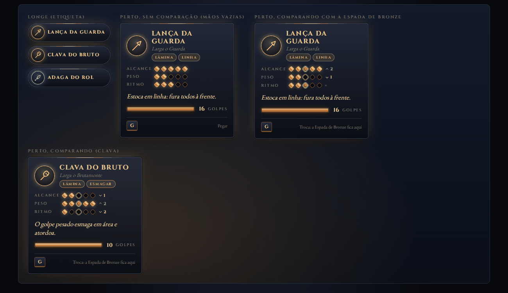
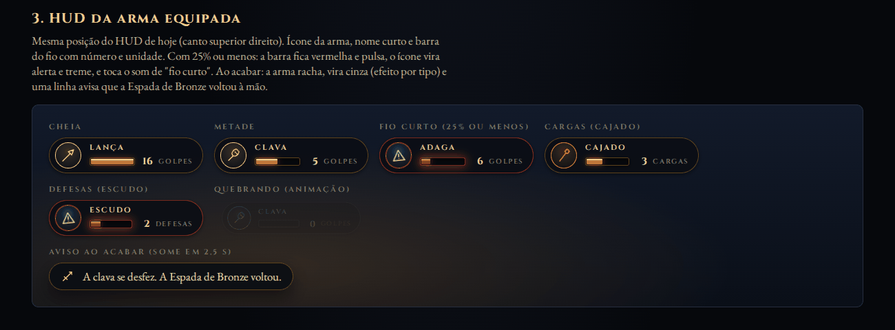
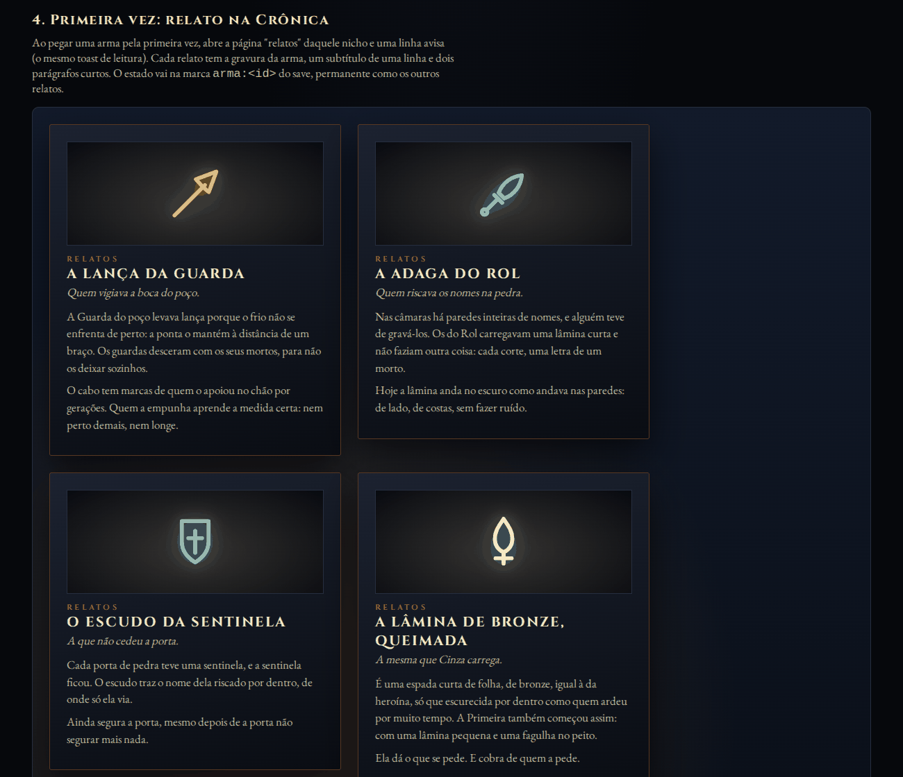
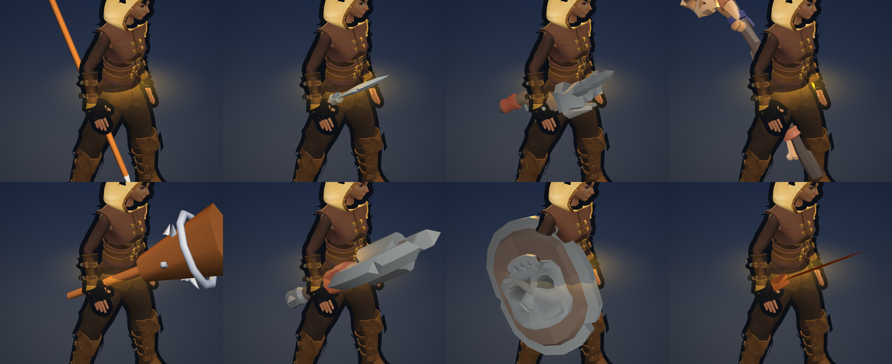
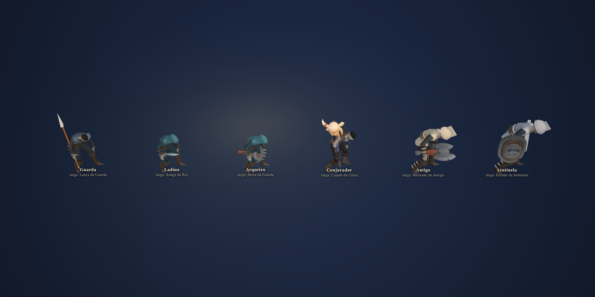

# Spec: Armas capturadas (identidade, comunicação e modelos)

Status: PROPOSTA de design, pesquisa e protótipo de página (nada foi integrado ao jogo). Marcações:
`[NORMATIVO]`, `[ASPIRACIONAL]`, `[A DEFINIR]`; procedência `[CÓDIGO]`, `[DESIGN]`, `[ASSET]`, `[MEDIDO]`
(número tirado do protótipo na pasta `prototipo/mocks/armas/`).

Snapshot: 2026-11-02, branch `armas` (a partir de `integracao`).
Substitui e amplia a seção 3 de [`spec-combate-profundo.md`](spec-combate-profundo.md) (captura de arma).
Relaciona-se com [`spec-exploracao-livros-e-sabedoria.md`](spec-exploracao-livros-e-sabedoria.md) (Linhas),
[`spec-pocoes-e-absorcao.md`](spec-pocoes-e-absorcao.md), [`biblia-bestiario.md`](biblia-bestiario.md),
[`direcao-de-arte.md`](direcao-de-arte.md), [`spec-ui-hud-ux.md`](spec-ui-hud-ux.md) e o canon em
[`narrativa-e-historia.md`](narrativa-e-historia.md) seção 0.

Peças de apoio (todas fora do jogo):
- `prototipo/mocks/armas/index.html` (+ `armas.ts`): comparação 3D dos modelos sob a luz e a câmera alta do jogo.
  Vistas: `?vista=catalogo|chao|perto|maos|mao|mortos`, `&arma=<id>`, `&quadro=0..1&acao=light`.
- `prototipo/mocks/armas/ui.html` (+ `ui.ts`): cartão de pegar, comparação, HUD e Crônica, só com tokens do design system.
- `prototipo/public/models/armas/` (pacotes baixados, um por pasta) e `prototipo/public/models/CREDITS.txt`.
- `docs/brasa/img/armas/` (as capturas citadas abaixo).

---

## 0. Resumo

1. O problema não é de número, é de leitura: hoje a arma capturada é um buff com nome, sem forma, sem cor própria,
   sem relação visível com quem a largou, e a heroína a carrega flutuando ao lado, com a espada de bronze ainda na mão.
2. Proposta: **cada família de morto larga a arma que ele carregava**, e essa arma é o **verbo** dele. O que o morto
   fazia contra você (a guarda estocava, o ladino cortava pelas costas, o arqueiro mirava de longe), você faz com ele.
3. Conjunto: **7 armas capturáveis e 1 relíquia** (Lança da Guarda, Adaga do Rol, Besta da Guarda, Cajado de Cinza,
   Clava do Bruto, Machado do Antigo, Escudo da Sentinela, e a Lâmina da Primeira, herança do Guardião).
   Todas expressas como **sobrescritas do `AttackTuning` que já existe** e do Golpe de Fogo; nenhuma tecla nova, nenhum clipe novo.
4. Durabilidade única, o **Fio** (golpes, virotes, cargas ou defesas), sem cronômetro escondido. A arma pertence à
   câmara: ao acender o braseiro, vira cinza (canon: o braseiro devolve o repouso).
5. Comunicação em três tempos: halo e ícone de longe; **cartão** (ícone, nome, 3 medidores, uma linha, Fio) perto, já
   comparando com a arma atual; **HUD** com ícone e barra, aviso de fio curto e quebra; **relato** na Crônica na primeira vez.
6. Modelos: **KayKit Skeletons e Adventurers (CC0)** para 5 armas (1 malha cada, ~0,2 MB no total) e **3 procedurais**
   (lança, clava, relíquia). Os outros pacotes avaliados (OpenGameArt Tedium, Quaternius) ficam como candidatos recusados.
7. Plano em 5 fases (seção 5); a primeira (dados) e a segunda (interface) paralelizam.

---

## 1. Diagnóstico: por que hoje não se entende o que cada arma faz

Feedback do usuário (jogando no Chrome real): "sinto falta de modelos de armas diferentes, e também não está claro o
que cada arma conquistada dos monstros faz". As causas, com a evidência no código `[CÓDIGO]`:

| # | Causa | Evidência |
|---|---|---|
| 1 | **Nenhuma pista antes da morte.** Os mortos não carregam nada nas mãos (têm ossos `hand_r` e `hand_l`, mas `skeleton.ts` não anexa arma). A arma "aparece do nada" no chão. O jogador não liga o drop ao inimigo. | `skeleton.ts` (sem `buildSword`/`hand_r`); captura `nos-mortos.png` mostra a alternativa |
| 2 | **O prompt diz só o nome.** "[G] Pegar Clava". Não mostra o que muda, quanto dura, nem se é melhor que a arma atual. | `main.ts:1254` |
| 3 | **A unidade do contador muda de arma para arma e o HUD é texto puro.** "Clava (5)" conta golpes pesados; "Espada (12)" conta acertos; "Cajado (3x)" conta bolas de fogo. A clava ainda tem um cronômetro de 10 s que o HUD nunca mostra. | `combatDirector.ts:368`, `main.ts:1261` |
| 4 | **O efeito é invisível.** Espada: "todo golpe corta 1,5x" é só um número maior, sem forma, sem som, sem cor. Clava: o smash existe, mas nada o anuncia. Cajado: a bola de fogo sai de cada acerto, o que ensina "pancada = fogo", não "cajado = magia". | `combatDirector.ts:707-760` |
| 5 | **A arma flutua.** A capturada é um nó solto a (0,45; 1,0; 0,5) do tronco, enquanto a espada de bronze continua presa à mão. A heroína fica com a espada na mão e um bastão voando ao lado. | `combatDirector.ts:360-365`, `heroModel.ts:229-240` |
| 6 | **Três armas, três verbos, só um deles é novo.** A espada capturada é "a mesma espada, mais forte" e nunca é uma troca interessante (sempre melhor). Só a clava (área) e o cajado (distância) mudam o que o jogador faz. | tabela de tuning, seção 2.6 |
| 7 | **Mapa de drops arbitrário.** Brutamonte, pesado e antigo largam clava; conjurador e demônio largam cajado; guerreiro e sentinela largam espada. A sentinela, um tanque com escudo, larga uma espada; o demônio, um monstro, larga um cajado. A lógica "família de morto, arma de assinatura" não existe. | `skeleton.ts:241-257` |
| 8 | **Perda silenciosa.** A arma some ao trocar de andar (`clearEnemies` chama `removeWeapon`), o drop do chão some em 20 s, e pegar outra arma descarta a atual sem aviso. Cada morte de uma família que dropa gera um drop, então a sala fica com várias iguais. | `combatDirector.ts:441`, `:322`, `:355` |
| 9 | **Cor errada para o sentido.** O halo da espada é azul gelo (`#cfe2ff`), a cor que o design system reserva à ameaça dos mortos ("nunca positivo"); as outras são um laranja igual para tudo. | `combatDirector.ts:318`, `tokens.css` |
| 10 | **Diverge do próprio spec.** A seção 3 de `spec-combate-profundo.md` diz que o cajado dá bolas de fogo "grátis no E" (tecla do fogo). O código dispara uma bola em todo acerto de melee. O spec não menciona a espada. | `spec-combate-profundo.md:53-56` |
| 11 | **Pouco sistema ao redor.** Nada liga a arma capturada à Sabedoria (Lâmina, Fogo, Contragolpe), nem à Crônica (nenhum relato de arma), nem às poções. | `codex.ts`, `spec-exploracao-livros-e-sabedoria.md` |
| 12 | **Orçamento.** A clava atual tem 9 malhas (9 chamadas de desenho por arma); o cajado, 3; o escudo do herói, 3. Com 3 drops de clava a sala perde ~30 chamadas. [MEDIDO] | `proc-clava-atual` no mock |

Duas amarras técnicas que a solução precisa respeitar `[CÓDIGO]`:
- `HeroCombat.heavyAttack` compara por identidade (`activeTuning === HERO.heavy`) e o diretor decide "pesado quebra
  guarda" por `hitStopFrames >= 8`. Trocar os objetos de tuning exige um marcador explícito (`kind: "light" | "finisher" | "heavy"`), senão a animação e a quebra de guarda erram.
- A detecção de acerto é uma esfera à frente do herói que acerta **um alvo por golpe** (mais o respingo `cleave`). Lança em linha, machado em arco e projétil precisam de formas novas de acerto (seção 5, fase 3).

---

## 2. O conjunto de armas

### 2.1 Princípios `[NORMATIVO]`

1. **A arma é o verbo do morto.** Cada família larga a sua arma de assinatura, e o comportamento da arma é o
   comportamento que o morto tinha. Matar um Arqueiro e pegar a Besta ensina a besta; matar o Antigo e pegar o machado
   ensina a quebrar escudos. O cartão e o relato dizem isso numa linha.
2. **Um verbo por arma, medido em comportamento e não só em número.** Cada arma muda uma coisa que o jogador *faz*
   (posição, ritmo, distância, defesa), com um custo claro. Nenhuma é "a espada, mais forte".
3. **Troca interessante com a espada de bronze.** Nenhuma arma capturada tem DPS de um único alvo muito acima da
   base (23,0 por segundo no combo de 3, ver 2.3); todas cobram em alcance, mobilidade, estamina, cancelamento ou
   exposição. O Fio curto garante que seja ferramenta de momento, não build.
4. **A arma pertence à câmara.** Ao acender o braseiro (ou trocar de andar), a arma vira cinza. Canon: o braseiro
   devolve o repouso aos mortos (bestiário 1.3); o que era deles volta a ficar com eles.
5. **Sem tecla nova, sem clipe novo.** O especial usa a tecla do Golpe de Fogo (custo de Fagulha), reformado pela arma.
   Os golpes reusam os clipes da biblioteca (`anim.glb`, seção 4.5).
6. **Uma mão, uma arma.** A heroína segura a arma capturada em `hand_r`, no lugar da espada de bronze (que fica oculta
   e volta quando o Fio acaba). A mão esquerda continua com a brasa.

### 2.2 Tabela mestre

| Família de morto (`SkeletonKind`) | Arma | Verbo | Linha de Sabedoria | Fio | Modelo |
|---|---|---|---|---|---|
| Guarda (`warrior`) | **Lança da Guarda** | Alcance e linha: fura todos à frente | Lâmina | 16 golpes | procedural |
| Ladino e Espreitador (`rogue`, `espreitador`) | **Adaga do Rol** | Ritmo e flanco: rápida, dobra o golpe pelas costas | Contragolpe | 28 golpes | KayKit Adventurers `dagger` |
| Arqueiro (`arqueiro`) | **Besta da Guarda** | Distância: virote reto, perfurante no pesado | Fogo | 10 virotes | KayKit Skeletons `Skeleton_Crossbow` |
| Conjurador (`conjurador`) | **Cajado de Cinza** | Área e fogo: orbe lento que queima, coluna marcada no chão | Fogo | 8 cargas | KayKit Skeletons `Skeleton_Staff` |
| Brutamonte (`brutamonte`) | **Clava do Bruto** | Esmagar: lenta, o pesado atordoa em área | Lâmina | 10 golpes | procedural |
| Antigo (`antigo`) | **Machado do Antigo** | Romper: arco largo que abre a guarda do escudo | Lâmina | 12 golpes | KayKit Skeletons `Skeleton_Axe` |
| Sentinela e Pesado (`sentinela`, `heavy`) | **Escudo da Sentinela** | Guardar: bloqueio sem custo, o golpe vira empurrão | Contragolpe | 8 defesas | KayKit Skeletons `Skeleton_Shield_Large_A` |
| Guardião (chefe) | **Lâmina da Primeira** (relíquia) | O preço: mais forte, bebe a sua vida | (nenhuma) | sem Fio, custa vida | procedural |
| `minion`, `demonio` | nenhuma | o minion é o povo comum, sem arma de ofício; o demônio é monstro, não é do povo | | | |

Por que `demonio` e `minion` não largam: o canon diz que os mortos são o povo do reino (seção 0 da narrativa);
o aldeão não tem ofício que lhe dê uma arma, e o demônio (Quaternius Monsters) é exceção registrada, não é gente.
Ambos continuam largando Essência e Fagulha. O `heavy` é o morto com escudo e elmo (`guards: true`, modelo da Sentinela, "silhueta de quem bloqueia"), por isso larga o **Escudo**, junto com a Sentinela; a Clava fica só com o Brutamonte (hoje o `heavy` larga uma clava, uma arma que a silhueta dele não carrega: diagnóstico 7).
O `antigo` deixa de largar clava e passa a largar o Machado.

Taxas de drop `[A DEFINIR]` (recomendação): Sentinela 100%, Brutamonte 100%, Antigo 70%, Conjurador 60%, Pesado 70% (Escudo),
Arqueiro 45%, Guarda 40%, Ladino 35%, Espreitador 35%. No máximo **2 drops no chão** ao mesmo tempo (o 3º dissolve o mais antigo), sem expirar por tempo.

### 2.3 Referência de números e como compor `[CÓDIGO]` `[MEDIDO]`

Base da espada de bronze (`tuning.ts`): leve 9 de dano em 0,38 s (0,10 + 0,05 + 0,23), finalizadora 11 em 0,50 s,
combo de 3 = 29 em 1,26 s = **23,0 de DPS**; pesado 26 em 0,80 s (35 de estamina) = **32,5 de DPS**, respingo de 55%
a 2,8 m; Golpe de Fogo 22 de dano, alcance 5,5 m, `arcCos` 0,5, 1 Fagulha. Acerto: esfera de raio 0,7 a 1,0 m à
frente (alcance efetivo 1,7 m do centro, mais o raio do alvo). Inimigos: 30 a 200 de vida, 12 a 95 de poise; costas
dão x1,5 de dano e +50% de poise, flanco x1,2; poise zerado = cambaleio de 0,6 s e +30% de dano; escudo (`guards`)
amortece o leve frontal para 35% e cai com `hitStopFrames >= 8`.

**Composição.** Uma arma capturada é um **objeto `WeaponDef`** que sobrescreve campos de `AttackTuning` (dano,
antecipação, recuperação, poise, `cleave`, `lunge`, `staminaCost`, `cancelAt`, `hitStopFrames`) e acrescenta quatro
campos de acerto: `reach` (onde fica a esfera, base 1,0 m), `radius` (base 0,7 m), `shape` (`esfera`, `capsula`,
`cone`, `projetil`) e `fio`. Camadas, da base para o topo:
1. `HERO.*` (a espada de bronze) ou a `WeaponDef` da arma segurada: valores base.
2. Sabedoria (`applyWisdom`): somas **sobre a base efetiva** (janela do combo, alcance do fogo, início do pesado). A tabela 2.5 diz o que cada degrau faz com cada arma; a Linha continua valendo.
3. Dádivas e poções: multiplicam o dano final (`damageMul`: Golpista, Ressonância, Elixir de Fúria).
4. Dificuldade.

### 2.4 Fichas

Convenção das tabelas: "ciclo" = antecipação + ativo + recuperação, em segundos. "Estamina" só aparece quando difere
do que a base cobra (leve 0, pesado 35). "Respingo" é o `cleave`. Todos os números são **pontos de partida** para o
playtest, na régua de `tuning.ts`.

#### 2.4.1 Lança da Guarda (Guarda)

- **Silhueta e nome.** Haste longa (~2,0 m) com ponta de folha de ferro; a mais alta e fina das armas, lê-se de longe
  como uma linha vertical. Nome do jogo: Lança da Guarda. Cor: ouro (Lâmina).
- **Quem a larga.** O Guarda, o morto comum de lâmina. O bestiário já previa o "lanceiro" (3.5): a guarda do poço
  levava lança porque o frio não se enfrenta de perto.
- **O que a distingue.** Acerto em **cápsula** de 0,5 a 2,35 m à frente (raio 0,45 m): **fura todos** os alvos na linha.
  Alcance efetivo 2,35 m contra 1,70 m do bronze (+38%). Em compensação, a ponta tem **zona morta**: alvo a menos de
  0,9 m leva só 60% do dano. Perde o respingo radial. Ensina espaçamento (distância ideal) e alinhar inimigos.

| Golpe | Ciclo | Dano | Poise | Knockback | Outros |
|---|---|---|---|---|---|
| Leve "Estocada" | 0,43 (0,12/0,05/0,26) | 8 | 7 | 1,5 | lunge 0,2; `cancelAt` 0,3 |
| Finalizadora (3o) "Estocada funda" | 0,54 (0,16/0,06/0,32) | 14 | 12 | 5 | fura; hitstop 6 |
| Pesado "Arremeto" | 0,80 (0,30/0,08/0,42) | 24 | 30 | 6 | **lunge 2,4 m** (cobre distância); estamina 30; quebra guarda (hitstop 8) |
| Especial (Golpe de Fogo) "Estocada de brasa" | 0,64 | 22 + Queimadura | 16 | 5 | linha de 7,0 m (`arcCos` 0,93) em vez de leque; 1 Fagulha |

- **Fio:** 16 (cada golpe que acerta gasta 1, o pesado gasta 2; furar vários alvos não gasta mais). Acaba: a haste racha e vira cinza.
- **Equilíbrio contra o bronze:** combo de 3 = 30 em 1,40 s = **21,4 de DPS (-7%)**, pesado 30 de DPS (-8%) em alvo único;
  em fila de 3 inimigos, até x3 (na prática x2: +85%). Cobra: zona morta, sem respingo, estamina do pesado 30.
- **Sinergias.** Lâmina II (finalizador varre mais): a Estocada funda ganha +0,8 m de linha. Lâmina III: pesado -0,06 s. Fogo I: a Estocada de brasa ganha +0,8 m (7,8 m). Elixir de Fúria: o Arremeto vira 38 de dano em todos no trajeto.

#### 2.4.2 Adaga do Rol (Ladino e Espreitador)

- **Silhueta e nome.** Lâmina curta e curva, ~0,6 m, cabo envolto. A menor arma do conjunto; por isso a leitura de
  longe depende do halo, do rastro e do som. Cor: gelo (Contragolpe).
- **Quem a larga.** O Ladino e o Espreitador, os que golpeiam e recuam. Lore: o Rol é a ordem dos que gravavam os
  nomes na pedra (casa com o livro "Rol dos Nomes").
- **O que a distingue.** **Ritmo e flanco.** Combo de **5** golpes rápidos; **pelas costas x2,0** (de x1,5) e pelo flanco
  x1,5 (de x1,2), com +100% de poise nas costas. A esquiva custa **17 de estamina** (de 25) enquanto a segura. O pesado
  é um **Passo cortante**: atravessa o alvo (3 m, 0,18 s de i-frames) e termina **atrás** dele, já em posição de x2,0.
  Alcance curto (esfera a 0,75 m, raio 0,6: 1,35 m efetivos) e dano e poise baixos: não interrompe os grandes.

| Golpe | Ciclo | Dano | Poise | Knockback | Outros |
|---|---|---|---|---|---|
| Leve (golpes 1 a 4) | 0,24 (0,05/0,04/0,15) | 5 | 4 | 0,5 | hitstop 2; `cancelAt` 0,15; lunge 0,45 |
| 5o golpe "Estocada" | 0,37 (0,10/0,05/0,22) | 10 | 10 | 4 | lunge 0,8 |
| Pesado "Passo cortante" | 0,48 (0,08/0,10/0,30) | 14 em quem atravessa | 8 | 2 | dash 3,0 m; i-frames 0,18 s; estamina 20 |
| Especial "Passo de brasa" | 0,64 | 22 + Queimadura | 16 | 5 | dash de 3,5 m (`arcCos` 0,9), i-frames 0,2 s; 1 Fagulha |

- **Fio:** 28 (leve e finalizadora 1 por acerto; pesado 2). Acaba: a lâmina se parte ao meio.
- **Equilíbrio:** combo de 5 = 30 em 1,33 s = **22,6 (-2%) de frente; ~45 (+96%) pelas costas**; poise por segundo 16,7
  contra 23,7 (-30%). O ganho existe só se o jogador circular; de frente, é mais fraca e mais exposta.
- **Sinergias.** Contragolpe I (esquiva perfeita dá +25% por 1,5 s) fica mais fácil de acionar com a esquiva barata.
  Contragolpe III (golpe após perfeito varre 3 m): a adaga ganha cleave de 3 m no 5o golpe. Poções: Fúria multiplica o x2,0 (a adaga pelas costas com Fúria faz 16 por golpe).

#### 2.4.3 Besta da Guarda (Arqueiro)

- **Silhueta e nome.** Besta de osso e corda com crânio de chifres na testa; arcos transversais largos, lê-se bem
  mesmo curta (0,85 m). Cor: brasa (Fogo).
- **Quem a larga.** O Arqueiro (bestiário 3.3: o vigia que guarda o corredor de longe).
- **O que a distingue.** **Distância.** O leve dispara um virote reto; o pesado atravessa até 3 alvos. Usa o pipeline
  do projétil amigo que já existe (`spawnFriendlyFireball`) e a mira do lock-on; sem modo de mira novo. De perto
  (menos de 1,8 m) o disparo sai 35% mais fraco. Sem lunge. O herói fica parado na antecipação (já é assim: golpe trava a locomoção).
  **Exceção ao `spec-combate.md` 3.5** (sem projétil como verbo): só vale para arma capturada, e o cajado já abriu o precedente.

| Golpe | Ciclo | Dano | Poise | Knockback | Outros |
|---|---|---|---|---|---|
| Leve "Disparo" | 0,60 (0,22/0,03/0,35) | 11 | 6 | 1,5 | virote 22 m/s, alcance 14 m; 1 virote; de perto x0,65 |
| Pesado "Virote perfurante" | 0,98 (0,45/0,03/0,50) | 22 em até 3 | 20 | 3 | estamina 15; 2 virotes |
| Especial "Virote em chama" | 0,64 | 16 + 2 Queimaduras, até 3 | 12 | 3 | alcance 14 m; 1 Fagulha |

- **Fio:** 10 virotes. Pegar uma segunda besta soma +50% do máximo (regra geral, seção 2.6). Acaba: a corda arrebenta.
- **Equilíbrio:** 11 por 0,60 s = **18,3 (-20%)** por alvo, mas sem receber golpe de melee; o pesado em fila rende 22 por alvo. O risco: os pilares bloqueiam a linha, e ela é inútil colada num brutamonte.
- **Sinergias.** Fogo I (alcance do fogo) aumenta o alcance do Virote em chama; Fogo III (Rastro) soma +1 s à Queimadura. Fúria: virote de 17.6.

#### 2.4.4 Cajado de Cinza (Conjurador)

- **Silhueta e nome.** Vara longa (1,75 m) rematada por um **crânio** de chifres (o modelo dos mortos do pacote);
  a luz da brasa sai dos olhos (esfera emissiva pequena, 2a malha). Cor: brasa (Fogo).
- **Quem a larga.** O Conjurador (o morto que lança o orbe lento e telegrafado de 0,95 s). A leitura é simétrica: o
  que o conjurador fazia, o jogador faz, e com o mesmo telégrafo legível.
- **O que a distingue.** **Área e fogo, devagar.** O orbe é lento (7 m/s) e acompanha levemente o alvo travado; a
  Coluna marca o chão por 0,6 s (inimigos ágeis escapam). Enquanto o cajado está na mão, a Fagulha regenera x1,6.
  Corpo a corpo, não defende nada: pouca vida de arma, dano direto baixo.

| Golpe | Ciclo | Dano | Poise | Knockback | Outros |
|---|---|---|---|---|---|
| Leve "Orbe" | 0,70 (0,28/0,03/0,39) | 12 + respingo 7 (raio 1,4 m) + 1 Queimadura | 8 | 2 | 1 carga; orbe 7 m/s, vive 2,2 s |
| Pesado "Coluna" | 1,15 (0,55 de conjuração + 0,60 de aviso no chão) | 28 em raio 2,0 m + 2 Queimaduras | 20 | 4 | 2 cargas; sem estamina |
| Especial "Nova de cinza" | 0,64 | 18 em raio 3,8 m (360 graus) | 20 | 6 | 1 Fagulha |

- **Fio:** 8 cargas (Orbe 1, Coluna 2). Acaba: o crânio apaga os olhos e a vara cai em cinza.
- **Equilíbrio:** orbe direto 12/0,70 = **17,1 (-26%)**, mais a Queimadura (2 por segundo por pilha, +10% de dano tomado) e o respingo: ~21 e x2 em grupos. Perde para o bronze em 1 contra 1 e ganha contra hordas e contra os que ficam parados.
- **Sinergias.** Fogo II (leque mais largo) alarga a Nova; Fogo III dá +1 s de Queimadura nas Colunas. Queimador (dádiva) soma pilhas. O cajado é a melhor arma para a gangorra de luz do Guardião (cada acerto reacende).

#### 2.4.5 Clava do Bruto (Brutamonte)

- **Silhueta e nome.** Cabo grosso e cabeça em cone invertido com cinta e tachas de ferro; a maior massa do conjunto,
  lê-se como "pancada" mesmo vista de cima. Cor: ouro (Lâmina, pela Linha do pesado).
- **Quem a larga.** O Brutamonte (só ele). Lore: a viga com que os carregadores empurravam as lajes das câmaras.
- **O que a distingue.** **Esmagar.** Tudo é lento e legível (o próprio inimigo vê o golpe vir) e **sem lunge e sem
  cancelamento** (não dá para cancelar a recuperação em esquiva): ela compromete. Em troca, o leve já cambaleia
  médios em 2 golpes e o pesado é um terremoto que atordoa tudo em 3,0 m.

| Golpe | Ciclo | Dano | Poise | Knockback | Outros |
|---|---|---|---|---|---|
| Leve "Pancada" (golpes 1 e 2) | 0,60 (0,18/0,07/0,35) | 16 | 20 | 4 | raio 0,85; hitstop 5; sem lunge; sem `cancelAt` |
| Finalizadora "Quebra" | 0,74 (0,24/0,08/0,42) | 22 | 35 | 7 | respingo 2,4 m; quebra guarda (hitstop 8) |
| Pesado "Esmagar" | 1,00 (0,50/0,08/0,42) | 40 (respingo de 50% em 3,0 m) | 60 (30 nos vizinhos) | 8 | estamina 35; hitstop 10; atordoa 0,5 s quem tem poise 65 ou menos |
| Especial "Chão em brasa" | 0,64 | 22 + Queimadura em 3,4 m (360 graus) | 16 | 5 | 1 Fagulha |

- **Fio:** 10 (leve e finalizadora 1; Esmagar 2). Acaba: a cabeça racha ao meio.
- **Equilíbrio:** combo 2 + finalizadora = 54 em 1,94 s = **27,8 (+21%)**; pesado 40 de DPS (+23%) e 20 em cada vizinho. É a que mais bate e a que mais expõe: 1,0 s de pesado sem cancelar contra o telégrafo de 0,6 s dos outros mortos.
- **Sinergias.** Lâmina III (pesado começa 0,06 s antes) é o remédio do ponto fraco. Lâmina II aumenta o respingo da Quebra. Fúria: Esmagar de 64 mata Guardas (60) de uma pancada; **ponto de playtest** (candidato a teto de dano, como a spec de Sabedoria já prevê para o Rastro).

#### 2.4.6 Machado do Antigo (Antigo)

- **Silhueta e nome.** Lâmina larga em duas meias-luas sobre cabo enrolado em osso e tira; cabeça grande e cinza,
  lê-se bem de cima. Cor: ouro (Lâmina).
- **Quem a larga.** O Antigo, o morto de profundidade (bestiário 3.4 pedia "machado ou maça grande"). Lore: o
  machado de quem cavou o poço; talha pedra, não pede licença a escudo.
- **O que a distingue.** **Romper.** Golpe em **arco de 140 graus** (cone, alcance 2,2 m, até 3 alvos). Acertar um inimigo
  que **guarda** ignora o bloqueio e **abre a guarda dele por 3,0 s**: o único jeito de neutralizar de vez Sentinela, Pesado e Brutamonte sem esperar a abertura. Custa **8 de estamina por golpe** e **não cancela** a recuperação.

| Golpe | Ciclo | Dano | Poise | Knockback | Outros |
|---|---|---|---|---|---|
| Leve "Talho largo" | 0,54 (0,16/0,08/0,30) | 14 em cada um (até 3) | 18 | 3 | cone 140 graus; estamina 8; lunge 0,2; sem `cancelAt` |
| Finalizadora | 0,66 (0,20/0,08/0,38) | 18 | 28 | 6 | estamina 8; hitstop 7 |
| Pesado "Racha" | 0,90 (0,40/0,08/0,42) | 36 (x1,5 em quem guarda: 54) | 50 | 7 | estamina 35; hitstop 9 |
| Especial "Talho em chamas" | 0,64 | 24 + 2 Queimaduras, 180 graus, 3,2 m | 16 | 5 | 1 Fagulha |

- **Fio:** 12. Acaba: o fio se estilhaça e o cabo fica em pó de osso.
- **Equilíbrio:** combo = 46 em 1,74 s = **26,4 (+15%)** por alvo (x até 3); pesado 40 (+23%). Pagam: 8 de estamina por golpe (a cadência cheia gasta 14,8 por segundo, comendo a reserva de esquiva), sem cancelamento e alcance de 2,2 m em cone (menos que a lança).
- **Sinergias.** Lâmina II alarga o cone em 20 graus e +0,6 m. Contra o Guardião, que guarda no overhead, abre a guarda por 3 s (aproveita a janela do cambaleio de luz).

#### 2.4.7 Escudo da Sentinela (Sentinela e Pesado)

- **Silhueta e nome.** Escudo alto e largo de aço com aro de bronze e **máscara de crânio** no umbo; o único que a
  heroína segura **de frente**, como parede (silhueta de círculo achatado, diferente de qualquer arma de haste).
  Cor: gelo (Contragolpe).
- **Quem a larga.** A Sentinela e o Pesado, os dois mortos com escudo (bestiário 3.2: "teimosia póstuma", o guarda que não cede a porta).
- **O que a distingue.** **Guardar.** Com o escudo, o **bloqueio** (Q) **não gasta estamina**: cada golpe aparado gasta
  1 de Fio (2 se for pesado). A janela de bloqueio perfeito ganha +0,08 s; o perfeito faz o **Rebate**: o atacante
  perde 60 de poise e é empurrado 3 m. O golpe leve é um **golpe de escudo** (dano 6, poise 30): cambaleia rápido, mata devagar.
  Golpe inquebrável continua exigindo esquiva; projéteis são barrados.

| Golpe | Ciclo | Dano | Poise | Knockback | Outros |
|---|---|---|---|---|---|
| Leve "Golpe de escudo" (1 e 2) | 0,40 (0,10/0,05/0,25) | 6 | 30 | 5 | lunge 0,3 |
| Finalizadora "Empurrão" | 0,50 (0,14/0,06/0,30) | 8 | 40 | 9 | respingo 2,0 m; hitstop 7 |
| Pesado "Investida" | 0,70 (0,25 + 0,30 de corrida/0,15) | 14 em quem atravessa | 45 | 7 | dash 3,2 m; quebra guarda; estamina 30 |
| Especial "Contra-brasa" | 0,64 | 14 + Queimadura em 2,2 m, 3,0 s | | | 1 Fagulha: cada golpe aparado explode em fogo nos atacantes |

- **Fio:** 8 defesas (aparar 1 ou 2, golpe de escudo não gasta). Acaba: o escudo racha e cai em lascas.
- **Equilíbrio:** combo = 20 em 1,30 s = **15,4 (-33%)**, o pior dano do conjunto; poise por segundo 75 contra 23,7 (3,2x). Vale contra elites (Sentinela de 200 de vida) e chefe; péssimo contra horda e contra quem tem golpe inquebrável.
- **Sinergias.** Contragolpe I a III valem aqui mais que em qualquer arma (Resposta: o leve após o perfeito começa em 0,07 s; Fio da Brasa: varre 3 m e devolve 0,25 Fagulha). Lâmina II: o Empurrão varre 3,2 m.

#### 2.4.8 Lâmina da Primeira (relíquia do Guardião)

- **Silhueta e nome.** A mesma espada curta de folha de bronze da heroína (a forma já existe em `buildSword`),
  **escurecida**, com brasas apagadas na lâmina; lê-se imediatamente como "a espada dela, mas queimada". Cor:
  ouro pálido (relíquia). O Guardião a empunha (`guardiao.ts`: "lâmina carbonizada na mão direita").
- **Quem a dá.** O Guardião (a Primeira Acendedora). O chefe é o último andar: um drop nele não tem uso na mesma
  descida. Por isso **não é captura**: é herança de uma descida seguinte (pergunta 9).
- **O que a distingue.** **O preço.** Todos os golpes do bronze x1,45 (leve 13, finalizadora 16, pesado 38) e cada
  golpe aplica 1 pilha de Queimadura, mas **cada golpe que acerta custa 1,5 de vida** e a Sede da Brasa não cura
  enquanto a segura. Abaixo de 30% de vida a lâmina **recusa**: volta aos valores do bronze e deixa de cobrar.
- **Fio:** nenhum (o custo é a vida). Sai ao acender o braseiro como as outras.
- **Equilíbrio:** combo = 42 em 1,26 s = **33,4 (+45%)**; cobra ~3,6 de vida por segundo de combate, 2,6% do máximo (140). Uma luta de 20 s custa ~72 (51%): é a arma de quem sabe o preço (canon: o custo do reino é uma vida por geração).

### 2.5 Sabedoria aplicada às armas `[NORMATIVO]`

Regra: a Linha soma sobre os valores da arma na mão; nunca é ignorada.

| Degrau | Efeito base | Em armas capturadas |
|---|---|---|
| Lâmina I (janela +0,08 s) | combo | vale em todas |
| Lâmina II (finalizador varre 3,2 m, +1 de knockback) | finalizadora | Lança: linha +0,8 m. Adaga: 5o golpe com respingo 2,0 m. Clava: Quebra com raio 3,2 m. Machado: cone +20 graus e +0,6 m. Escudo: Empurrão 3,2 m. Besta e Cajado: +1 alvo perfurado, +0,4 m de respingo |
| Lâmina III (pesado 0,06 s mais cedo, +10 de poise) | pesado | vale em todas |
| Fogo I (+0,8 m) | alcance do fogo | no especial da arma (linha, dash, nova) |
| Fogo II (leque mais largo) | arco do fogo | lança e besta: linha 50% mais larga; demais: leque +25 graus |
| Fogo III (Rastro: +1 s de Queimadura e 0,5 Fagulha com 3 alvos) | queimadura | vale nas Queimaduras do cajado, besta e especiais |
| Contragolpe I a III | esquiva e bloqueio perfeitos | Escudo e Adaga aproveitam mais; as outras, igual ao bronze |

Reflexo na arma (Sabedoria 3, 6, 9): o brilho da ponta já previsto na spec de livros funciona com arma de arquivo:
um **material próprio por tipo de arma** (não por instância) aceita um `emissiveColor` somado; o custo é 1 material
por tipo na cena, sem chamada de desenho extra (seção 5.3).

### 2.6 Regras gerais `[NORMATIVO]`

- **Drop.** Surge onde o morto caiu, com o halo da Linha. Sem tempo de vida; some quando o braseiro acende. Máx. 2 no chão.
- **Pegar.** `G` perto (2,2 m). Se já há arma na mão, **troca**: a atual cai aos pés com o Fio que sobrou (dá para voltar). Pegar a **mesma** arma que já segura **recarrega 50%** do máximo.
- **Acabar.** O Fio zera, a arma se desfaz (efeito por tipo), a espada de bronze volta, e uma linha curta avisa por 2,5 s.
- **Entre andares.** A arma vira cinza ao acender o braseiro. Retomar a descida (save) não restaura arma.
- **Poções e Brasa.** Elixir de Fúria multiplica o dano final. Poção de Recuperação e Unguento, sem interação. A barra de Erupção (X) não muda; a Erupção mantém a arma.
- **Dádivas.** Golpista e Ressonância multiplicam. Sede da Brasa cura normalmente, exceto com a Lâmina da Primeira.
- **Guarda de balanço.** Se uma arma passar de +25% de DPS contra o bronze no playtest sem custo visível, o corte vai primeiro no Fio, depois no dano.

### 2.7 Contas de equilíbrio (resumo)

| Arma | DPS leve ou combo | vs. bronze (23,0) | DPS pesado | vs. bronze (32,5) | O que cobra |
|---|---|---|---|---|---|
| Bronze | 23,0 | 0% | 32,5 | 0% | |
| Lança | 21,4 | -7% | 30,0 | -8% | zona morta, sem respingo; x2 a x3 em fila |
| Adaga | 22,6 de frente; ~45 de costas | -2%; +96% | 29 (Passo) | -10% | alcance 1,35 m, poise baixo, circular |
| Besta | 18,3 | -20% | 22 por alvo (x3) | -31% por alvo | fraca de perto, depende de linha de visão |
| Cajado | 17,1 + queima (~21) | -9% | 24 em área | -26% | lento, sem defesa, só 8 cargas |
| Clava | 27,8 | +21% | 40 | +23% | sem cancelar, sem lunge, 1,0 s no pesado |
| Machado | 26,4 por alvo | +15% | 40 | +23% | 8 de estamina por golpe, sem cancelar, cone curto |
| Escudo | 15,4 | -33% | 20 | -38% | mata devagar; poise 3,2x |
| Lâmina da Primeira | 33,4 | +45% | 47 | +45% | 1,5 de vida por golpe |

---

## 3. Comunicação (sem texto longo)

Protótipo navegável: `prototipo/mocks/armas/ui.html`. Capturas: `img/armas/ui-cartao-pegar.png`, `ui-todas.png`,
`ui-hud.png`, `ui-cronica.png`.

### 3.1 Cartão de pegar `[NORMATIVO]`

Hoje: `[G] Pegar Clava` a 2,2 m. Passa a dois estágios:

1. **De longe (até 5 m): etiqueta.** Halo da cor da Linha no chão (já existe `createLightPool`) e uma etiqueta
   projetada em tela com ícone e nome (a mesma técnica de `exitMarkers.ts`). Serve para achar a arma sem se aproximar.
2. **Perto (até 2,2 m): cartão** `ds-weapon` (292 px), de cima para baixo:
   - ícone num selo redondo na cor da Linha, **nome** em Cinzel, subtítulo "Larga o Guarda" (a ligação com o morto);
   - dois **chips**: a Linha (Lâmina, Fogo, Contragolpe) e a característica (Linha, Flanco, Distância, Área, Esmagar, Rompe guarda, Guarda, Preço);
   - **3 medidores** de 5 losangos: **Alcance, Peso, Ritmo**. Sem comparação, só os losangos acesos;
   - **uma linha de efeito** em EB Garamond itálico (máx. ~45 caracteres);
   - **Fio** em barra (`ds-bar`) com número e unidade (golpes, virotes, cargas, defesas);
   - rodapé: `ds-kbd` **G** e a nota "Troca: a Espada de Bronze fica aqui" quando há arma na mão.
3. **Comparação com a arma atual (sem texto).** Cada medidor ganha uma **marca oca** no losango da arma atual e uma
   **seta com número** (verde para cima, rosa para baixo, igual quando empata). Alcance 5 contra 3 mostra "^2". O
   olho lê "melhor em alcance, pior em peso" sem ler uma frase. Marca e seta usam **forma**, não só cor.
4. **Medidores (régua 1 a 5)** `[A DEFINIR]` Alcance = alcance efetivo; Peso = dano por golpe e poise; Ritmo = velocidade do ciclo:

| Arma | Alcance | Peso | Ritmo |
|---|---|---|---|
| Espada de Bronze (referência) | 3 | 3 | 3 |
| Lança | 5 | 2 | 3 |
| Adaga | 1 | 1 | 5 |
| Besta | 5 | 3 | 2 |
| Cajado | 4 | 2 | 2 |
| Clava | 2 | 5 | 1 |
| Machado | 3 | 4 | 2 |
| Escudo | 1 | 2 | 3 |
| Lâmina da Primeira | 3 | 4 | 3 |

Acessibilidade: o cartão tem `role="group"` com o nome da arma; os medidores têm `aria-label="5 de 5"`; texto segue
`uiScale`; sem pulso em "reduzir movimento" (o mock tem `?movimento=reduzido`).

### 3.2 HUD da arma equipada `[NORMATIVO]`

Mesma posição de hoje (canto superior direito, `.hud-weapon`). Pílula com **ícone** da arma no selo da Linha, **nome curto**
e a **barra do Fio** com número e unidade. Estados:
- **Cheia e metade:** barra de brasa (`ds-bar` ember).
- **Fio curto (25% ou menos):** a barra fica vermelha e **pulsa**, o ícone vira o alerta (forma) e **treme**, toca um tique de metal; sem movimento reduzido, a pílula só muda de cor e mostra o alerta parado.
- **Quebra:** a pílula acende (brilho 2x) e se apaga em 0,7 s; efeito por tipo no mundo (a arma racha, o orbe apaga, a corda arrebenta, o escudo cai em lascas); linha de 2,5 s: "A clava se desfez. A Espada de Bronze voltou."
- **Lâmina da Primeira:** em vez de barra, o custo "1,5 de vida por golpe" com coração.

### 3.3 Cor, halo, forma e som por tipo `[NORMATIVO]`

Três cores de Linha (tokens novos em `tokens.css`): `--arma-lamina` (ouro `--gold-300`), `--arma-fogo`
(brasa `--ember-400`), `--arma-contra` (gelo `--frost-300`), mais `--arma-relic` (ouro pálido). O halo da espada
azul-gelo atual sai (azul é ameaça dos mortos); o gelo aqui aparece **só como cor de Linha**, sempre acompanhado do chip com o nome e do ícone, como a spec de Sabedoria já prescreve ("a Linha tem forma e cor, nunca só cor").

| Arma | Linha e cor | Ícone (silhueta) | Som ao acertar | Rastro do golpe |
|---|---|---|---|---|
| Lança | ouro | haste e folha em diagonal | estocada seca, assobio curto de haste | fita fina dourada |
| Adaga | gelo | lâmina curta e curva | tilintar fino e rápido, sem eco | fita curta azul pálido |
| Besta | brasa | arco transversal e virote | estalo de corda e silvo do virote | risco de brasa no virote |
| Cajado | brasa | vara com orbe e raios | sopro de brasa e estalo de cinza | cauda de brasa no orbe |
| Clava | ouro | cabo e cabeça com tachas | baque grave de madeira e pedra | poeira e onda no chão |
| Machado | ouro | lâmina em meia-lua | arrasto largo de ferro, golpe surdo | fita larga dourada |
| Escudo | gelo | escudo alto com nervura | gongo curto de metal sobre metal | clarão ao aparar |
| Lâmina da Primeira | ouro pálido | folha com chama | bronze que range, brasa fria | fita escura com faíscas |

O som segue a regra do `biblia-audio.md`: a leitura de cada tipo cabe no ouvido (a sala é escura). `combatSound.ts`
ganha um `weaponHit(kind)` e um `weaponBreak(kind)`; nada de arquivo novo se a síntese procedural já cobre (o jogo usa síntese).

### 3.4 A primeira vez vira relato na Crônica `[NORMATIVO]`

Ao pegar uma arma pela primeira vez: marca `arma:<id>` no save (permanente, como `markRead`/`markFloor`), toast "Crônica:
a lança da Guarda" e um nicho novo da categoria **relatos** em `codex.ts` (andar de origem da família, gravura nova em
`illustrations.ts` com o ícone da arma). Os textos abaixo são rascunho (`[A DEFINIR]` autoria final, como na spec de Sabedoria) e respeitam o canon: os mortos são o povo do reino; outras
Acendedoras desceram antes; o nome do reino não é afirmado; nada de gore.

| Arma | Título do relato | Subtítulo | Texto (2 parágrafos curtos) |
|---|---|---|---|
| Lança da Guarda | A lança da Guarda | Quem vigiava a boca do poço. | "A Guarda do poço levava lança porque o frio não se enfrenta de perto: a ponta o mantém à distância de um braço. Os guardas desceram com os seus mortos, para não os deixar sozinhos." / "O cabo tem marcas de quem o apoiou no chão por gerações. Quem a empunha aprende a medida certa: nem perto demais, nem longe." |
| Adaga do Rol | A adaga do Rol | Quem riscava os nomes na pedra. | "Nas câmaras há paredes inteiras de nomes, e alguém teve de gravá-los. Os do Rol carregavam uma lâmina curta e não faziam outra coisa: cada corte, uma letra de um morto." / "Hoje a lâmina anda no escuro como andava nas paredes: de lado, de costas, sem fazer ruído." |
| Besta da Guarda | A besta dos vigias | Quem guardava o corredor de longe. | "Os vigias ficavam onde o corredor se abre, porque dali se vê tudo o que desce. A besta é de quem tem paciência: arma, espera, solta." / "Mesmo mortos, miram com a calma de quem sabe que o corredor só tem uma entrada." |
| Cajado de Cinza | O cajado de cinza | Quem alimentava o fogo pequeno. | "Os braseiros precisavam de quem os cuidasse com a ponta de uma vara, soprando a cinza até voltar a ser brasa." / "O topo guarda um resto de calor. Quem o empunha sente que ele pede para ser gasto, e não para ser guardado." |
| Clava do Bruto | A clava dos carregadores | Quem fechou as câmaras com pedra. | "As portas de pedra não se fecharam sozinhas. Os carregadores empurravam as lajes com uma viga, e a viga, ao fim, virou arma de quem não sabia fazer outra coisa que não fosse empurrar." / "É lenta e todos veem o golpe chegar. Mas o que ela alcança, ela quebra." |
| Machado do Antigo | O machado de quem abriu o poço | Quem cavou a pedra do poço. | "Os mais antigos dos mortos são os que cavaram o poço. O machado é de talhar rocha, não de lutar, e por isso não pede licença a nenhum escudo." / "O fio é grosso e velho, e foi afiado tantas vezes que já quase não lembra a forma original." |
| Escudo da Sentinela | O escudo da Sentinela | A que não cedeu a porta. | "Cada porta de pedra teve uma sentinela, e a sentinela ficou. O escudo traz o nome dela riscado por dentro, de onde só ela via." / "Ainda segura a porta, mesmo depois de a porta não segurar mais nada." |
| Lâmina da Primeira | A lâmina de bronze, queimada | A mesma que Cinza carrega. | "É uma espada curta de folha, de bronze, igual à da heroína, só que escurecida por dentro como quem ardeu por muito tempo. A Primeira também começou assim: com uma lâmina pequena e uma fagulha no peito." / "Ela dá o que se pede. E cobra de quem a pede." |

### 3.5 Especificação no design system (`prototipo/src/game/ui/ds/`)

- `tokens.css`: `--arma-lamina`, `--arma-fogo`, `--arma-contra`, `--arma-relic`, `--fio-aviso` (= `--blood-400`).
- `components.css`: `ds-weapon` (+ `--mini`, `--atual`), `ds-meter` (medidor de 5 losangos, reaproveita `ds-pip` com `.ds-pip--c` e `.cur`), `ds-delta` (seta e número), `ds-fio` (barra de durabilidade sobre `ds-bar`, estados `low` e `break`). O CSS completo, só com tokens, está em `mocks/armas/ui.html`, pronto para migrar.
- `icons.ts`: 8 ícones novos `arma-lanca`, `arma-adaga`, `arma-besta`, `arma-cajado`, `arma-clava`, `arma-machado`, `arma-escudo`, `arma-lamina`, mais `chev-up`, `chev-down`, `alerta` (grade 24, traço 1,6; os caminhos estão em `mocks/armas/ui.ts`).
- `illustrations.ts`: 4 gravuras novas para os relatos (lança, adaga, escudo e lâmina como prioridade; as outras podem reusar o ícone grande até haver gravura).
- `ds-kbd` já cobre o `G`. `strings.ts`: `armaLanca` a `armaLamina` (nome), `armaOrigem*`, `armaEfeito*`, `fioUnidade*` (pt-BR e en), `avisoQuebra`, `avisoRecarga`.
- Substituir em `main.ts` o `pickupEl` e o `weaponEl` por dois componentes (`WeaponCard` e `WeaponHud`) num módulo `src/game/ui/weaponUi.ts`, deixando `main.ts` só com chamadas.

---

## 4. Modelos: pesquisa, medição e escolha

### 4.1 O que foi pesquisado `[MEDIDO]`

Critério: licença exata verificada na fonte, glTF/GLB (ou conversão sem perda), estilo compatível com KayKit/Quaternius,
e **1 a 2 malhas por arma** (cada primitiva é uma chamada de desenho). Capturas: `img/armas/candidatos-1.png` a `-4.png`.

| Pacote | Licença verificada em | Formato | Baixado | Resultado |
|---|---|---|---|---|
| **KayKit Character Pack: Adventurers 1.0** (Kay Lousberg) | `LICENSE.txt` do repositório: "Creative Commons Zero, CC0" | glTF (+ FBX); 1 primitiva por arma, paleta de textura 14 a 17 KB | sim: armas e escudos (472 KB em disco, com texturas) | **usado** (adaga) |
| **KayKit Character Pack: Skeletons 1.0** | `LICENSE.txt`: CC0 | glTF; 1 primitiva por arma, atlas 17 KB | sim: armas e escudos (344 KB em disco) | **usado** (besta, cajado, machado, escudo) |
| **OpenGameArt "Melee Weapons" (Tedium Interactive)** | página: "License(s): CC0"; sem arquivo de licença no zip | só FBX (12 armas, 48,9 KB); convertido com FBX2glTF | sim (GLB de 65 KB) | candidato recusado: muito fino e sem leitura da câmera alta (lança de 46 triângulos com ponta minúscula); material PBR metálico 0,4 e rugosidade 0,14 (escuro e brilhante na luz da cripta; foi forçado a 0 e 0,55 para a comparação ser justa) |
| **Quaternius Ultimate RPG Items (2019)** | `License.txt` no zip: "CC0 1.0 Universal" | FBX, OBJ e Blend (sem glTF); convertido | só 7 itens (zip de 44,6 MB fora do repo) | candidato recusado: 3 a 5 primitivas por arma (3 a 5 chamadas de desenho), cores escuras e foscas; Hammer_Double tem 1.918 triângulos |
| Kenney Mini Dungeon | página: "Creative Commons CC0"; v1.6 "Added weapons & shields" | não listado | **não** (download por script da página) | não avaliado (a série "Mini" tem estilo próprio; não foi vista) |
| Poly Pizza | licença **por modelo** (a busca "mace" mostra CC-BY 3.0 e CC0 misturados, e kits pagos) | glb | não | recusado: atribuição obrigatória por modelo e pacotes pagos |
| Quaternius Medieval Weapons (itch.io, 22 armas, 3,5 MB) | página: CC0 | FBX, OBJ, Blend | não (nome-seu-preço, sem download por script) | alternativa se o conjunto crescer |
| Quaternius Fantasy Props MegaKit | página: CC0 | FBX, OBJ, Blend, glTF | não verificado quanto ao nível gratuito | alternativa se o conjunto crescer |
| itch.io "Low Poly Simple Melee Weapon Pack" (Joe345), "Swordtember2022" (cc0gameassets) | páginas: CC0, GLB | glb | não (itch.io exige clique) | alternativas se precisar de mais variedade |

### 4.2 Medição por candidato (tabela do mock, `window.__stats`)

Triângulos e chamadas de desenho (primitivas) por arma; KB = arquivo glTF + bin + textura (a textura é compartilhada
entre armas do mesmo pacote, então o custo real do conjunto é menor).

| Arma | Candidato | Triângulos | Chamadas | KB | Nota |
|---|---|---|---|---|---|
| Lança | **procedural** | 88 | 2 | 0 | escolhida |
| | Spear (OGA Tedium) | 46 | 1 | 65 (o arquivo inteiro de 12 armas) | ponta ilegível de cima |
| Adaga | **dagger (KayKit Adventurers)** | 172 | 1 | 26,7 | escolhida |
| | Dagger (Quaternius) | 726 | 5 | 41,8 | escura, 5 chamadas |
| | Dagger (OGA) | 58 | 1 | 65 | bland |
| Besta | crossbow_1handed (KayKit Adv.) | 584 | 1 | 43,9 | boa |
| | **Skeleton_Crossbow (KayKit Skel.)** | 584 | 1 | 47,6 | escolhida: crânio de chifres, "morto" |
| | Bow_Wooden (Quaternius) | 660 | 3 | 38,2 | escuro |
| | Arco procedural | 92 | 2 | 0 | o arco é mais fino que a besta |
| Cajado | **Skeleton_Staff (KayKit Skel.)** | 1.519 | 1 | 87,2 | escolhida: crânio de chifres, o único da família que "conta" o conjurador |
| | staff (KayKit Adv.) | 440 | 1 | 37,1 | gema verde (fora da paleta de brasa) |
| | Staff (OGA) | 44 | 1 | 65 | uma vara |
| | Atual do jogo (procedural) | 484 | 3 | 0 | 3 chamadas |
| Clava | **Clava fundida (procedural, 2 malhas)** | 418 | 2 | 0 | escolhida |
| | Atual do jogo (procedural) | 418 | **9** | 0 | estoura o orçamento |
| | Club e Mace (OGA) | 68 e 128 | 1 | 65 | finas demais |
| | Hammer_Double (Quaternius) | 1.918 | 4 | 103,4 | é martelo de guerra |
| Machado | **Skeleton_Axe (KayKit Skel.)** | 534 | 1 | 44,4 | escolhida: cabo de osso e tira |
| | axe_2handed (KayKit Adv.) | 508 | 1 | 39,2 | boa, mais limpa |
| | Great Axe (OGA) e Axe_Double (Quaternius) | 148 e 1.556 | 1 e 4 | | fina; escura |
| Escudo | **Skeleton_Shield_Large_A (KayKit Skel.)** | 626 | 1 | 52,1 | escolhida: o escudo do próprio morto |
| | shield_spikes e shield_round (KayKit Adv.) | 420 e 284 | 1 | 37,8 e 28,6 | boas, genéricas |
| | Escudo do herói (procedural atual) | 1.194 | 3 | 0 | disco liso |
| Relíquia | **espada de bronze escurecida (procedural)** | 305 | 2 | 0 | reusa `buildSword` |

Peso do conjunto escolhido se fundido num único `armas.glb`: geometria ~164 KB + 2 texturas de paleta (14 e 17 KB) =
**~0,2 MB**; a heroína tem 0,99 MB. Cada arma é **1 malha** (o cajado tem uma 2a, o orbe de brasa, e a relíquia tem 2).

### 4.3 Pacote contra procedural

| | Pacote CC0 (KayKit) | Procedural em código (`weapons.ts`) |
|---|---|---|
| Aparência de perto | **melhor**: realces cozidos, ossos, tiras, crânios; combina com o resto do mundo KayKit | chapado e "de brinquedo"; a madeira vira laranja forte sob a luz de aro (ver `clava` e `lança` em `maos-de-perto.png`) |
| Leitura da câmera alta | boa nos grandes (machado, escudo, cajado); a adaga e a besta ficam pequenas (precisam de halo e rastro) | boa nos simples (lança, clava) |
| Peso | ~0,2 MB no total | 0 KB |
| Chamadas de desenho | 1 por arma (já vem fundido) | só ficam em 1 a 2 se forem **fundidas por material** (a clava atual faz 9) |
| Esforço | baixo (instanciar) e dependente do pacote ter a arma | médio (modelar por código) e fácil de ajustar |
| Licença | CC0, procedência registrada em `CREDITS.txt` | própria |

**Escolha:** pacote para as cinco armas que o KayKit tem (adaga, besta, cajado, machado, escudo) e **procedural fundido
(2 malhas)** para as três que não tem (lança, clava, relíquia). A lança e a clava podem ser trocadas por um futuro
pacote (Quaternius Medieval Weapons) sem mudar o resto: o mapa `arma -> modelo` é um dado.

### 4.4 Como a heroína segura de verdade

Hoje a arma capturada é um nó flutuante (diagnóstico 5). Proposta:
1. A arma capturada vai para `hand_r` (o mesmo osso e o mesmo encaixe da espada de bronze: posição (-0,035; 0,01; 0), rotação (π/2, 0, 0)), e a espada de bronze (`sword`, `sword_tip`, `sword_trail`) é **ocultada** enquanto isso. Conferido no mock: o osso está sem escala (1,0008), então o tamanho do modelo normalizado vale em metros.
2. Cada arma tem uma **pose de empunhadura** (`hold`: posição e rotação no osso), medida no mock: lança e cajado **em pé** (rotação (π, 0, 0), a ponta sobe ao lado do corpo), escudo **de frente** (rotação (0, π/2, 0), como parede), as demais com o encaixe padrão. Os valores ficam em `WeaponDef.hold`.
3. O rastro (`TrailMesh`) muda de cor por Linha e passa a nascer na ponta da arma segurada (nó `weapon_tip` por arma).
4. **Mortos com a arma na mão:** o mesmo modelo, em `hand_r` do morto (confirmado nos `morto_*.glb`: guerreiro, ladino, conjurador, antigo, sentinela), em **instâncias** (`createInstance`) de um único mesh por tipo: N mortos com a mesma arma custam 1 chamada de desenho. Só as famílias que largam arma a carregam. **Exceção:** o Brutamonte (`yeti.glb`) e o Espreitador (`ninja.glb`) são monstros Quaternius **sem osso de mão** (só `UpperArm.R` e `LowerArm.R`; checado nos nós do glb): a Clava e a Adaga entram presas ao fim de `LowerArm.R` com um deslocamento medido caso a caso (a mão do monstro é a malha do antebraço). É o ponto mais incerto da empunhadura e vai para a fase 2 como spike; se não ficar legível, o Brutamonte e o Espreitador largam a arma sem a carregar antes. O drop é **o mesmo objeto** que ele segurava (a arma "cai"): isso resolve o diagnóstico 1. Captura: `nos-mortos.png`.
5. Limites: mão única (sem segunda mão nem IK); em golpe a arma acompanha a mão do clipe, então lança e cajado "varrem" em vez de estocar até a fase 3 validar os clipes (seção 4.5).

### 4.5 Clipes disponíveis (`anim.glb`) `[MEDIDO]`

`Death01, Hit_Chest, Hit_Knockback, Idle_Loop, Jog_Fwd_Loop, Jump_*, LayToIdle, Melee_Hook, OverhandThrow, Punch_Cross,
Punch_Jab, Roll, Spell_Simple_Idle_Loop, Spell_Simple_Shoot, Sprint_Loop, Sword_Block, Sword_Idle, Sword_Regular_A,
Sword_Regular_B, Walk_Loop, Zombie_*`. Hoje o herói usa `Sword_Regular_A` (leve), `Sword_Regular_B` (pesado), `Sword_Block`,
`Spell_Simple_Shoot` (fogo) e `Roll`. **Hipótese de mapeamento** (validar na fase 3 com uma página de clipes, nada assumido como pronto):

| Arma | Leve | Pesado | Especial | Bloqueio |
|---|---|---|---|---|
| Lança | `Punch_Jab` (estocada reta) | `Sword_Regular_B` + lunge | `Spell_Simple_Shoot` | `Sword_Block` |
| Adaga | `Punch_Jab` e `Punch_Cross` alternados | `Roll` curto + `Sword_Regular_A` | `Spell_Simple_Shoot` | `Sword_Block` |
| Besta | `Spell_Simple_Shoot` | `OverhandThrow` | `Spell_Simple_Shoot` | `Sword_Block` |
| Cajado | `Spell_Simple_Shoot` | `Spell_Simple_Shoot` com pausa | idem | `Sword_Block` |
| Clava e Machado | `Melee_Hook` | `Sword_Regular_B` | `Spell_Simple_Shoot` | `Sword_Block` |
| Escudo | `Punch_Cross` (bate com o escudo) | `Sword_Regular_B` + lunge | `Spell_Simple_Shoot` | `Sword_Block` (com o escudo à frente) |

### 4.6 O que foi visto nas capturas

- Os modelos KayKit **leem bem** de perto e na câmera alta quando são grandes (machado, escudo, cajado com crânio, besta de crânio); a **adaga e a besta são pequenas** vistas de cima e precisam do halo, do rastro e do som para o jogador as reconhecer (`no-chao.png`, `camera-alta-1.png`).
- O procedural parece "de brinquedo" de perto (cone laranja da clava) mas **a silhueta lê** da câmera alta; a clava fundida (2 malhas) é visualmente igual à de 9 malhas e custa 7 chamadas a menos.
- Os candidatos de Quaternius saem escuros e fosco na luz do jogo; os de OpenGameArt são finos demais para a câmera alta.
- O halo por Linha funciona: ouro, brasa e gelo distinguem as famílias no chão sem texto.
- Com os mortos carregando a arma (`nos-mortos.png`), a ligação "quem larga, o que larga" é imediata: a lança do Guarda, o machado do Antigo, o escudo da Sentinela.
- A heroína de costas com a arma em `hand_r` esconde as menores atrás do corpo; as de haste e as largas aparecem (`camera-alta-2.png`).

Limitações do protótipo: a pose de golpe só foi vista em um quadro (machado, `quadro=0.45`); a lança do mock estoca como a espada por usar os mesmos clipes; as luzes são as do jogo (`getActorLight`) mas sem as tochas e o braseiro da sala; o contorno de tinta não foi aplicado às armas (no jogo o contorno do herói exclui a espada: `noOutline`).

---

## 5. Plano de implementação em fases

Orçamento de desempenho `[NORMATIVO]`: o teto atual de trabalho é **90 chamadas de desenho por sala** (os docs de arte ainda
dizem "< 60"; atualizar, ver 5.4). Cada arma: **1 a 2 malhas**. Custo previsto: arma na mão 1 a 2; até 2 drops no chão x
(1 arma + 1 halo) = 4; mortos com arma em **instâncias** = +1 por tipo (até ~4 tipos por sala) = +4;
total **+9 a +10** (10% do teto), contra os ~30 que 3 clavas de hoje já custam. Sem luz dinâmica nova (o halo é
`createLightPool`, sem luz); o orbe do cajado usa o emissivo do material (sem `PointLight`).
**Passes extras `[CÓDIGO]`:** o contorno (`outlineHierarchy`, `renderOutline`) desenha a malha uma 2a vez, e uma malha que projeta sombra (`addShadowCaster`) entra no passe de sombra. Por isso as armas (na mão, no chão e nos mortos) levam `metadata.noOutline` (como a espada de bronze já faz) e **não** são registradas como `shadowCaster` (o herói registra os filhos só no carregamento, então a arma anexada depois já fica de fora; manter assim); o aterramento fica com a sombra de contato do ator. Sem isso o custo estimado dobra (+1 por malha por passe).

### 5.1 Fases

| Fase | Entrega | Arquivos (principais) | Esforço | Depende de |
|---|---|---|---|---|
| **F0 Dados e acerto** | `WeaponDef` (dados puros), `heroCombat.setWeapon(def)` aplicando as sobrescritas, formas de acerto novas (cápsula, cone), marcador `kind` no `AttackTuning`, o diretor lendo a def em vez dos `if (clava/espada)` | novo `game/combat/weapons/weaponDefs.ts`; `combat/tuning.ts` (tipos); `combat/heroCombat.ts` (`strikeTuning`, `heavyAttack`, `emberTuning`); `combat/combatDirector.ts` (`detectHeroHits`) | médio | nada |
| **F1 Interface** | cartão, HUD, ícones, strings, tokens, marca e relato da Crônica, sons por tipo | `ui/ds/tokens.css`, `ui/ds/components.css`, `ui/ds/icons.ts`, `ui/ds/illustrations.ts`, `ui/strings.ts`, novo `ui/weaponUi.ts`, `app/main.ts` (troca de `pickupEl` e `weaponEl`), `content/codex.ts`, `content/saveData.ts`, `combat/combatSound.ts` | médio | só do **contrato** `WeaponDef` e do evento de pegar |
| **F2 Modelos e empunhadura** | `armas.glb` fundido (gltf-transform), carregador, `hold` por arma, arma na mão no lugar da espada, mortos com a arma (instâncias), drops com o mesmo objeto, fim do `rotation.x = 0,5` flutuante | `actors/weapons.ts`, `actors/heroModel.ts` (`attachProps`), `actors/enemies/skeleton.ts`, `combat/combatDirector.ts` (`spawnDrop`, `equipWeapon`), `public/models/armas/armas.glb` | médio | contrato de F0 |
| **F3 Mecânicas novas (uma por arma)** | clava e cajado portados primeiro (já existem); depois lança, machado, escudo, adaga e besta. Cada uma é um módulo que implementa `WeaponBehavior` (hooks: golpe, acerto, bloqueio, especial) | novo `combat/weapons/<id>.ts` por arma; `combatDirector.ts` (`spawnFriendlyFireball` generalizado, marca de chão da Coluna) | **alto** (somado) | F0; clipes validados |
| **F4 Ajuste e relíquia** | playtest de números (seção 2.7), áudio, efeitos de quebra, Lâmina da Primeira (herança), Sabedoria aplicada (2.5), taxas de drop | `tuning` das defs, `content/*`, `scenes/crypt/*` | médio | F1 a F3 |

Ordem: F0, depois **F1 e F2 em paralelo**, depois F3 arma a arma (duas pessoas podem trabalhar em armas diferentes
sem conflito, pois cada uma vive no próprio arquivo), por fim F4. Pontos de conflito: `combatDirector.ts` (F0 mexe em
`detectHeroHits`, F2 em `spawnDrop` e `equipWeapon`; combinar as regiões) e `main.ts` (só F1).

### 5.2 Entrega mínima (a primeira leva jogável)

F0 + F1 + F2 com **duas armas**: Clava (refeita) e Lança (nova), mais o cartão, o HUD e a mão. Isso já resolve o
feedback ("modelos diferentes" e "não está claro o que faz"). As demais entram uma a uma na F3.

### 5.3 Riscos

- **Clipes.** Estocada e bloqueio com escudo dependem dos clipes (seção 4.5); sem validar, a lança "varre". Spike de 1 dia na F3.
- **Identidade do `heavyAttack`** e **`hitStopFrames >= 8` como quebra de guarda** (seção 1): precisam do marcador antes de trocar as tunings.
- **Atlas.** As armas KayKit usam 2 texturas (knight e skeleton); fundir as duas num atlas único permite 1 material para todas. Se não fundir, são 2 materiais (ok).
- **Brilho de Sabedoria.** Exige 1 material por tipo de arma (não por instância); 8 materiais no pior caso.
- **Poder.** Fúria com Clava e Lâmina com Golpista são os candidatos a teto (2.4.5, 2.4.8).
- **Brutamonte e Espreitador sem osso de mão** (seção 4.4): empunhadura por deslocamento no antebraço, sem garantia de leitura.
- **Arma na mão dos mortos** muda a leitura do inimigo (mais itens na silhueta); testar o teste de silhueta em preto da direção de arte (3.1).

### 5.4 Impacto nos docs existentes

| Doc | Mudança |
|---|---|
| `spec-combate-profundo.md` seção 3 | marcar como substituída por este spec (clava de 10 s e 5 golpes, cajado "grátis no E") |
| `spec-combate.md` 3.5 | registrar a **exceção** do projétil só para arma capturada |
| `spec-combate-tier2-profundidade.md` linha 53 | a "clava capturada" passa a ser uma entre sete |
| `biblia-bestiario.md` seção 3 | cada ficha ganha "Arma de assinatura" (tabela 2.2); o demônio e o minion ficam sem |
| `direcao-de-arte.md` seção 3 e 5 | silhueta das armas no teste em preto; armas em 1 a 2 malhas; teto de chamadas de desenho (de < 60 para 90, se confirmado) |
| `spec-ui-hud-ux.md` | `ds-weapon`, `ds-fio` e o HUD da arma |
| `spec-exploracao-livros-e-sabedoria.md` seção 3 | o "brilho da ponta da arma" fica resolvido (material por tipo, 2.5) |
| `biblia-audio.md` | `weaponHit` e `weaponBreak` por tipo (3.3) |
| `narrativa-e-historia.md` | nenhuma mudança de canon; os relatos 3.4 entram em `codex.ts` |
| `biblia-vestuario.md` | linha 322 ("arma de assinatura") passa a apontar para a tabela 2.2 |

---

## 6. Perguntas fechadas para o usuário (cada uma com a recomendação)

1. **Conjunto.** Fazer as **7 armas + a relíquia**, em levas? Recomendação: sim, em levas (primeira leva: Clava e Lança; depois Cajado, Machado, Escudo, Adaga, Besta). Alternativa: cortar a Besta e a Adaga (as duas pequenas e mais caras de mecânica).
2. **A arma sobrevive ao braseiro?** Recomendação: **não**, vira cinza ao acender (canon do bestiário 1.3, e evita acumular). Alternativa: leva para o próximo andar com metade do Fio.
3. **Durabilidade.** Um **Fio único por golpes** (sem cronômetro)? Recomendação: sim. Alternativa: manter o tempo na clava.
4. **Drops.** Taxa por família, máx. 2 no chão, **sem expirar**? Recomendação: sim (as taxas da seção 2.2). Alternativa: sempre dropar e expirar em 20 s como hoje.
5. **Troca ao pegar.** A arma atual **cai aos pés** com o Fio que sobrou? Recomendação: sim. Alternativa: descartar sem aviso (hoje).
6. **Projétil como verbo.** Abrir a **exceção** do `spec-combate.md` 3.5 para Besta e Cajado? Recomendação: sim, só para arma capturada.
7. **Modelos.** Adotar **KayKit Skeletons e Adventurers (CC0)** para cinco armas e **procedural fundido** para lança, clava e relíquia? Recomendação: sim; descartar os candidatos de OpenGameArt e Quaternius (apagar as pastas na F2).
8. **Empunhadura.** **Uma mão só**, com pose por arma (sem segunda mão nem IK)? Recomendação: sim. Alternativa: segunda mão nas armas de duas mãos (lança, machado, cajado), custo alto.
9. **Lâmina da Primeira.** (a) **herança** depois da primeira vitória, opcional no começo da descida; (b) nunca; (c) drop do chefe. Recomendação: **(a)**, e fora da primeira leva.
10. **Mortos com arma na mão** (instâncias)? Recomendação: sim; resolve a causa nº 1 do diagnóstico com custo de ~4 chamadas.
11. **Teto de chamadas.** Atualizar os docs de arte de "< 60" para **90**? Recomendação: sim, se o `perf90` for o novo teto.
12. **Espada capturada de hoje (x1,5).** **Remover**, substituída pela Lança? Recomendação: sim (era a espada "só mais forte").

---

## 7. Em aberto

- **Números** são pontos de partida (seção 2.7); a ordem de grandeza foi checada contra `tuning.ts` e `STATS`, mas nada foi jogado.
- **Clipes** de estocada, tiro e bloqueio com escudo: hipótese da seção 4.5.
- **Taxas de drop** e **tamanho do Fio** por arma dependem de quantos mortos de cada família há por sala (`ROSTER` de `main.ts`).
- **Som:** a descrição por tipo está feita; a síntese em `combatSound.ts` não.
- **Brutamonte e Espreitador** (monstros sem osso de mão) carregam a arma só se o spike de `LowerArm.R` funcionar.
- **Gravuras** dos relatos (4 prioritárias) e a **pose de golpe** de cada arma na câmera alta (só um quadro foi visto).
- **Kenney Mini Dungeon, Quaternius Medieval Weapons e MegaKit** não foram baixados; ficam como alternativa se o conjunto crescer.
- **Validação no Chrome real** do usuário: as capturas foram feitas com Chromium no GPU local (ANGLE, Intel), não no navegador do usuário; conferir a leitura do halo e das silhuetas lá.
